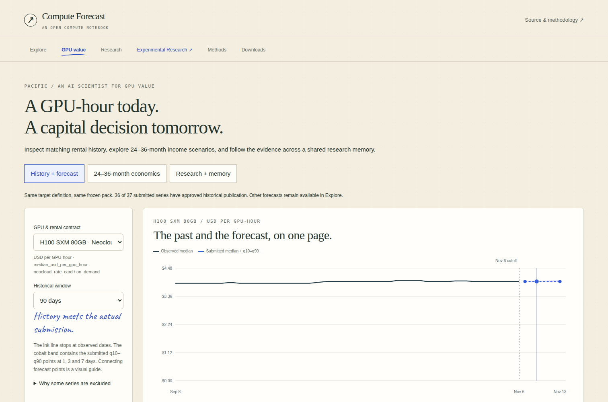
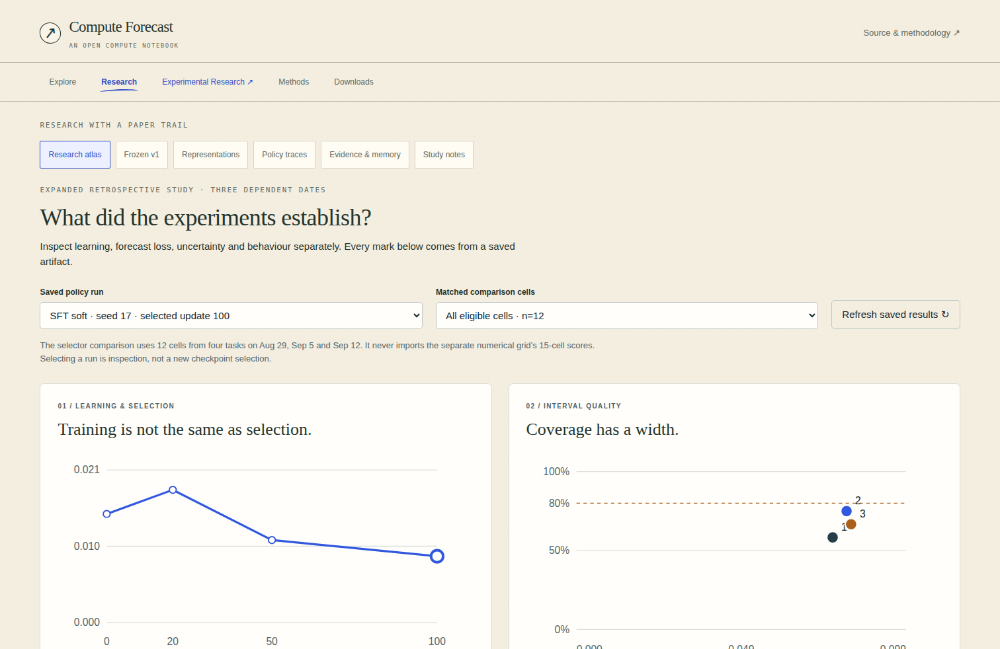
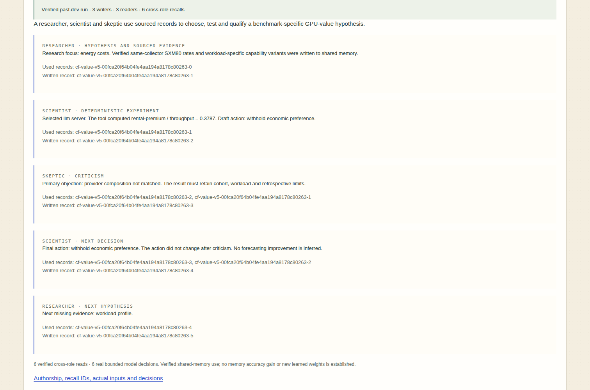
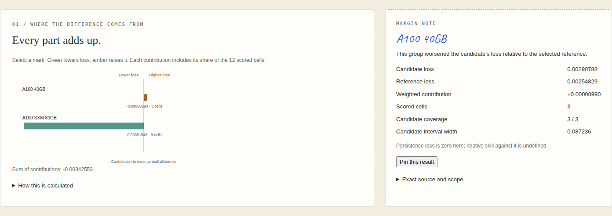

# Compute Forecast

**A GPU-value research notebook: rental history, archived forecasts and conditional capital economics.**

Explore advertised rental prices, inspect an archived forecast, and see how explicit assumptions change longer-term pricing paths. The research atlas connects saved model checkpoints, forecast scores, uncertainty, and actual experiment-selection decisions.

[GPU value and shared research memory](https://howdymary--compute-forecast-observatory-web.us-east.modal.run/#value) · [Explore the notebook](https://howdymary--compute-forecast-observatory-web.us-east.modal.run) · [Research atlas](https://howdymary--compute-forecast-observatory-web.us-east.modal.run/#research) · [Results and downloads](results/README.md) · [Methods](docs/README.md)

*Actual permitted history and the unchanged November 6 submission. Missing dates remain missing; the forecast contains only the submitted 1/3/7-day points. Screenshots come from the verified deployed application.*

## What you can explore

- **Matching benchmark history.** 3,204 permitted observations across 36 of the 37 exact submitted target series, with the November 6 cutoff and unchanged forecast points. The remaining marketplace-ask history stays withheld under a source-specific caveat. [Publication decision](docs/DATA_SOURCES.md).
- **Independent historical context.** Independently licensed A100 40GB and T4 hyperscaler-spot series: 234 observed dates each, January 12–November 6, 2026, with 65 missing calendar dates. Gaps remain visible. This context failed the strict numerical-identity check against competition targets and is never stitched to their forecasts.
- **Archived benchmark forecasts.** The exact November 6, 2026 submission: 37 headline series, 111 rows, 1/3/7-day horizons, and q10/q50/q90. This is an archived forecast, not a live quote.
- **Long-term economics.** Archived H100/A100 rental anchors, 24/36-month operating cashflows, operating break-even utilization and an income-based residual proxy. Adjustable assumptions and explicit discounting keep this separate from observed resale prices. The original index-100 rental/resale scenarios remain available.
- **Research results.** Actual checkpoint curves, matched controls, coverage versus interval width, paired action traces, and separate accounting for cached reveals, fresh executions, optimizer updates, time, and partial provider receipts.

## Pacific value study and shared memory

The [GPU value notebook](https://howdymary--compute-forecast-observatory-web.us-east.modal.run/#value) now joins permitted **matching** history to actual submitted forecast points. It keeps independent historical context separate.

The unchanged official starter was rerun on the same 12-cell retrospective A100 cohort. Empirical persistence and drift both score **0.01326771**, versus **0.01590833** for last value. These are matched integrity checks, not new untouched test results or the full competition leaderboard.

The long-term explorer makes the economic mechanism inspectable: advertised rate → realized revenue assumption → utilization and operating costs → discounted operating income and a separate tail-income residual proxy. The annual paths are assumptions, not estimates inferred from news. [Equations, source evidence and conditional results](docs/pacific-value-v5.md).

**past.dev is verified:** three distinct roles wrote, three read, and six cross-role recalls supplied records used in actual research tasks. A scientist tested a workload-specific rental/throughput ratio; a skeptic flagged unmatched provider populations. The final publication action did not change. No forecasting gain from memory is claimed. [Authorship, actual recall receipts, setup diagnosis and storage map](docs/past-dev-memory.md).

The first v5 setup failed because a 44-character audience ID exceeded past.dev's 40-character limit. The ID is now 30 characters, errors retain sanitized receipts, and a failed memory gate fails the workflow. [Successful execution](https://github.com/howdymary/compute-forecasting/actions/runs/43758970371) · [Isolated API regression check](results/value-v5/runs/43759581339/setup-diagnostic.json).

## What the research found

The two policy studies have different evaluation scopes and must not be pooled.

| Study | Comparison | Pinball loss ↓ | Evaluation scope |
| --- | --- | ---: | --- |
| Frozen v1 | Starting policy | 0.01735406 | 30 cells across five dependent dates |
| Frozen v1 | Selected SFT policy | 0.01781945 | Same cells; **2.68% worse** |
| Expanded v2 | Starting selector | 0.01499533 | 12 eligible cells across three dependent dates |
| Expanded v2 | Development-selected operational SFT | 0.01156980 | Same cells; **22.84% lower** |
| Additional control | Fixed zero-shot Chronos-2 | 0.01211355 | Same 12 cells; additional retrospective comparison |

The expanded campaign completed **six SFT runs / 600 optimizer updates** and **three RL runs / 99 updates**. All three RL selections returned update zero, their frozen SFT parent: there was **no incremental RL gain**.

Feedback-hidden controls tie in forecast loss in five of six SFT runs. Some tied runs nevertheless change their action sequences. Changed behaviour and improved forecasting are separate questions.

The policy evaluations and retrospective Chronos control cover **A100 series only**. They do not establish H100 policy performance or general research intelligence. V2 reuses previously inspected dates; its improvement is not an untouched or prospective result. Three dependent dates do not establish population calibration.

[Full campaign findings](docs/campaign-v2-findings.md) · [Frozen v1 representation findings](docs/representation-findings.md) · [Chronos control and publication audit](docs/research-explorer-v3.md)

## What the review adds

The [Findings notebook](https://howdymary--compute-forecast-observatory-web.us-east.modal.run/#research) decomposes the measured gain by GPU, origin and horizon. A hash-verified replay finds that the operational SFT policy tests the same four tree configurations on all four evaluation tasks: feedback changes order, while the selected configurations and losses remain the same. This is a post-hoc explanation, not a preregistered portfolio win. Raw prediction equality remains unavailable.

A fresh November 15 source capture still ends on November 6 for both licensed series; prospective issuance requires compatible fresher observations.

The new 48-episode evidence/criticism diagnostic found no improvement from relevant evidence for frozen SFT; criticism worsened its score. An 18-cell retrospective interval diagnostic lowered loss with wider intervals. Future selector and interval outcomes remain pending, and further training is gated on broader informative tasks.

[Executed v4 findings](docs/review-v4-findings.md) · [Forward-only market context](docs/market-context-v4.md) · [Credential-free operation checks](.github/workflows/verify-public-v4.yml)

[Review v4 methods and remote workflows](docs/review-v4.md) · [Mechanism and contribution data](results/review-v4/findings.json) · [Registered prospective panel](configs/prospective-selector-v4.json)

## Inspect the evidence without credentials

The [results directory](results/README.md) contains versioned, hash-indexed snapshots of the official forecast, numerical summaries, checkpoints, paired traces, contextual history, and scenario assumptions. Raw competition offers, restricted source excerpts, private model paths, and credentials are excluded.

- [Official forecast CSV](results/frozen-v1/forecasts.csv)
- [Expanded campaign results](results/expanded-v2/summary.json)
- [Chronos-2 control and future commitment](results/explorer-v3/chronos-control.json)
- [Historical context, permissions, and paired traces](results/explorer-v3/history-and-traces.json)
- [Artifact checksums and provenance](results/manifest.json)

A separate **14-series / 42-row prospective commitment** targets November 16, 18, and 22, 2026. Outcomes remain pending. The locked evaluator cannot score before November 23 UTC and additionally requires verified compatible outcome data. Both comparators use the same stale November 6 snapshot.

## Reproduce and validate

The interface uses HTML, CSS, JavaScript, and SVG, served by FastAPI on Modal. Numerical tools score forecasts deterministically; a Tinker-trained Qwen policy selects bounded experiment configurations. Exa retrieves dated primary evidence; past.dev connects evidence, deterministic experiments, criticism and next decisions. This current-research loop is separate from historical benchmark inputs.

A credential-free pack-based command reproduced the official CSV byte for byte in [remote run 43758970357](https://github.com/howdymary/compute-forecasting/actions/runs/43758970357):

~~~sh
python -m compute_forecast.reproduce_pacific_v5 --pack /path/to/gpu-price-pack-v0.1.1-handover --out /path/outside-pack/reproduction
~~~

After installing this package and the pack's starter requirements, this command checks all 672 manifest entries and preserves the source pack. To verify published arithmetic without the pack or provider accounts, run `python -m compute_forecast.verify_value_v5`. [Passed public reconstruction](https://github.com/howdymary/compute-forecasting/actions/runs/43759952952).

1. Start with the [reproduction guide](docs/campaign-v2-reproduction.md) and [frozen v1 protocol](docs/protocol.md).
2. Numerical reruns require the separately obtained, unchanged source pack. Training additionally requires Tinker access; saved private checkpoints are not bundled here.
3. Configure the documented GitHub Actions secrets and use the remote workflows on `compute-observatory`. The workflows verify source hashes, archive manifests, cutoffs, and output contracts.
4. Audit the committed snapshots without accounts, or reproduce recorded decisions from the [derived research archive](https://howdymary--compute-forecast-observatory-web.us-east.modal.run/experimental/downloads/43677783872.zip). New training is stochastic and should receive its own run identity.

The current deployment passed **130 tests**, with one optional dependency skip. [V5 validation](https://github.com/howdymary/compute-forecasting/actions/runs/43760739987) checks matching history, exact quantiles, economic calculations, eight concurrent value/memory reads, immutable pins, keyboard/touch controls and widths 1512, 390 and 320. [Current PNG and validation provenance](results/value-v5/ui-publication.json). Earlier v4 checks remain linked below. [Pricing](https://github.com/howdymary/compute-forecasting/actions/runs/43755238685), [Findings](https://github.com/howdymary/compute-forecasting/actions/runs/43755238539), [notebook](https://github.com/howdymary/compute-forecasting/actions/runs/43755238564), [experimental](https://github.com/howdymary/compute-forecasting/actions/runs/43755238561), and [research-explorer](https://github.com/howdymary/compute-forecasting/actions/runs/43755238565) checks passed. Desktop and mobile PNGs were inspected; layout and interaction checks passed at 1512, 390 and 320 pixels. The stress check retains eight simultaneous callers, exact numerical assertions and zero automatic retries. [Image and validation provenance](results/review-v4/ui-publication.json).

## Repository guide

| Directory | Contents |
| --- | --- |
| [src/compute_forecast](src/compute_forecast) | Forecasting, policy training, evaluation, publication, and interface code |
| [configs](configs) | Registered experiments, immutable selection boundaries, and model revisions |
| [results](results/README.md) | Public numerical snapshots, forecast exports, and provenance |
| [docs](docs/README.md) | Methods, findings, related work, data definitions, and reproduction guides |
| [tests](tests) | Cutoff, scoring, publication, and contract checks |
| [.github/workflows](.github/workflows) | Remote experiments, validation, artifact publication, and deployment |

## Sources and reuse

The data measures **advertised rental offers**, not transactions, guaranteed capacity, or physical GPU resale prices. Provider/configuration normalization has established precedents, including [Silicon Data](https://www.silicondata.com/products/silicon-index) and [SemiAnalysis](https://semianalysis.com/gpu-pricing-index/).

Independent historical context is derived from [Alex Hubbard's GPU Price Tracker](https://github.com/alex-hubbard/gpu_price_tracker) under its explicit CC BY 4.0 data license. The verified current brief grants CC BY 4.0 on the compilation; approved matching v5 target histories are now published with component notices and attribution. The marketplace-ask history remains withheld under its specific caveat. Model, library, and data licenses apply independently; see [sources and publication rights](docs/DATA_SOURCES.md) and [attribution](NOTICE.md).

For citation metadata, see [CITATION.cff](CITATION.cff).
