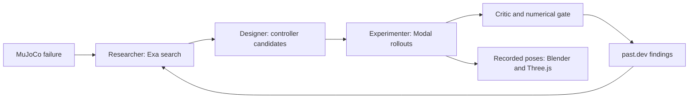

# MOCHI: Autonomous Robot Policy Optimization

Mochi investigates failed robot actions, searches for a better controller, and tests the change in simulation. Four model-driven roles handle research, policy design, experimentation, and criticism. A miniature humanoid shows the resulting motion in a desk scene.

[Video walkthrough][walkthrough] · [Live demo][demo] · [Mochi source][code] · [Expanded experiment][expanded-run] · [Architecture][architecture]

**Code location:** the Mochi project is in `mochi/` on the **`mochi-hackathon`** branch. The clone command below selects that branch.

![Mochi's original mechanical humanoid design on a desk][robot-image]

*The mechanical humanoid is a visual design around a supported manipulation experiment. The evaluated task is puck pushing; the bowling props are a proposed task.*

## The research loop

Mochi pushes a puck toward a target ring. After a failed attempt, the system searches for a mechanism that could explain the failure, proposes bounded controller changes, and evaluates candidates across environment seeds. A model critic reviews the evidence; a deterministic improvement gate can veto acceptance.



The policy-editing interface can select controller families and change bounded parameters. The simulator, success verifier, and evaluation scenarios remain outside that interface. The selected policy is frozen before held-out evaluation.

The demo replays completed experiments. Research sources, controller changes, critic decisions, and memory handoffs are linked to their execution records.

## Robot and control system

| Component | Implementation |
| --- | --- |
| Task | Push a puck into a target ring across varied starting positions, friction, and mass |
| Physics | MuJoCo 3.3.7, 500 Hz simulation |
| Control | State-based inverse kinematics and actuator control at 50 Hz; three actuated right-arm joints |
| Policy search | Controller-family selection and bounded speed, approach, contact-height, stopping, and feedback parameters |
| Success | Within 2.8 cm of the target for at least 0.5 seconds, persisting through the terminal state and validity checks |
| Episode | Six seconds |
| Visualization | Three.js pose replay and Blender renders of recorded body positions and quaternions |

This is supported upper-body manipulation with a simplified collision model. The legs and gripper details are visual elements. The project does not demonstrate walking, unsupported balance, dexterous grasping, newly trained neural motor policies, or transfer to a physical robot.

## Sponsor integrations

| Service | Role in the system | Implementation |
| --- | --- | --- |
| **Exa** | Searches from observed failures inside the main research loop. Retrieved sources motivate controller-family choices and remain attached to the experiment record. | [`Services.search`][integrations], [research loop][research], [expanded loop][robustness] |
| **Tinker** | Powers bounded decisions for all four roles: what to investigate, which controller family to test, which diagnostic to emphasize, and whether to accept a candidate. The expanded study used `Qwen/Qwen3.6-35B-A3B`. | [`Services.decide`][integrations], [`ExpandedServices`][robustness] |
| **Modal** | Executes policy × environment-seed rollouts in parallel, with deterministic seeds, at most eight CPU workers, and per-rollout resource and duration records. | [Original workers][remote], [expanded workers][robustness] |
| **past.dev** | Stores authored findings and supports cross-agent recall under explicit reader identities and audiences. A required source ID must be returned before the corresponding canonical artifact enters an agent's context. | [Memory adapters][integrations], [expanded ingestion and recall][robustness] |

The completed expanded study recorded **eight Exa searches, 33 Tinker decisions, 33 memory records, and 42 verified cross-agent reads**. Four identities both wrote and read. One of those reads repeated during checkpoint recovery.

## Measured results

Two studies use separate development and evaluation cohorts. Their results are reported separately.

| Study and evaluation set | Starting controller | Research-selected controller | Conventional search |
| --- | ---: | ---: | ---: |
| Initial study: held-out, 12 scenarios | 2/12 | 8/12 | 6/12 |
| Initial study: higher friction and mass, 8 scenarios | 2/8 | 1/8 | 6/8 |
| Expanded study: held-out mixture, 64 scenarios | 22/64 | **55/64** | 58/64 |
| Expanded study: high-friction/mass stress, 64 scenarios | 30/64 | **59/64** | 62/64 |

The expanded controller achieved **85.9% held-out success** and **92.2% stress success**. Its 95% Wilson intervals were 75.4–92.4% and 83.0–96.6%, respectively. Both improve on the starting controller. Matched random search finished higher in both cohorts; these experiments do not establish a causal advantage from research or memory.

The initial study completed **188 rollouts**. Its conventional control had access to a narrower controller family, which limits that comparison. The expanded study gives both search arms access to the same four families and the same parameter-sampling helper: **32 candidates × 24 development scenarios = 768 search rollouts per arm**.

The expanded protocol contains **2,016 rollouts**. Checkpoint recovery repeated 24 initial rollouts, bringing actual execution to **2,040**. The artifact audit verifies all 2,016 archived protocol rows, numerical summaries, disjoint seed cohorts, hashes, and required source-verified memory reads. Failed attempts remain in the workflow history.

[Initial execution][initial-run] · [Initial findings][initial-results] · [Expanded execution and downloadable artifact][expanded-run] · [Expanded method][expanded-method] · [Audit code][audit-expanded]

## Run the demo locally

Use Python 3.11. The committed replay works without provider API keys.

```sh
git clone --branch mochi-hackathon --single-branch https://github.com/howdymary/mochi-demo.git
cd mochi-demo
python3.11 -m venv mochi/.venv
mochi/.venv/bin/python -m pip install './mochi[dev]'
PYTHONPATH=mochi/src mochi/.venv/bin/python -m mochi.cli serve --port 8765
```

Open [localhost:8765](http://127.0.0.1:8765). The browser viewer uses public Three.js and font CDNs.

Run the physics checks, audit the committed initial-study pack, or execute a local conventional controller search:

```sh
PYTHONPATH=mochi/src mochi/.venv/bin/python -m pytest mochi/tests -q
mochi/.venv/bin/python mochi/scripts/audit_pack.py mochi/web/data
PYTHONPATH=mochi/src mochi/.venv/bin/python -m mochi.cli demo --out mochi/artifacts/local
```

The local search has its own budget and results. It does not call sponsor services or replace the committed study.

To audit the expanded study, download its completed Actions artifact:

```sh
gh run download 43769159917 --repo howdymary/mochi-demo --name mochi-robustness-43769159917 --dir mochi/artifacts/robustness-v2
mochi/.venv/bin/python mochi/scripts/audit_robustness.py mochi/artifacts/robustness-v2/report.json
```

New service-connected experiments require the `remote` dependencies and backend environment variables `EXA_API_KEY`, `PAST_API_KEY`, `TINKER_API_KEY`, `MODAL_TOKEN_ID`, and `MODAL_TOKEN_SECRET`. Keys stay on the backend. See the [capability inventory][inventory] and [Mochi workflows][workflows] for the configured execution paths.

## past.dev challenge

### Agents

The researcher writes sourced hypotheses and reads criticism. The designer reads research and writes candidate proposals. The experimenter reads proposals and writes measurements. The critic reads evidence and results, then writes a verdict that the researcher uses in its next task. Each role has its own instructions, identity, and working context.

### Layers

Agent prompts hold working context. past.dev holds authored findings and semantic evidence. Versioned Python defines procedures. JSON artifacts hold exact numerical payloads and trajectories. Recall must return the required source ID before the matching canonical artifact is supplied to the consumer.

### Results

The expanded study has four writers, four readers, 33 records, and 42 verified cross-agent recalls, including one recovery read. The initial study also passed a positive/negative critic-private canary test. That isolation test was not repeated in the expanded study.

### Caveats

No matched no-memory or no-search ablation has been completed. Verified handoffs demonstrate that memory was used; they do not establish that memory caused better policies. The synthetic isolation check covers one access boundary.

## Repository map

| Path on `mochi-hackathon` | Contents |
| --- | --- |
| [`mochi/src/mochi/`][source] | Simulation, policies, evaluation, research roles, service adapters, and API |
| [`mochi/configs/`][configs] | Success criteria, seed cohorts, and experiment budgets |
| [`mochi/web/`][web] | Animated research replay, source cards, comparison, and evidence interface |
| [`mochi/assets/blender/`][assets] | Original procedural humanoid design |
| [`mochi/scripts/`][scripts] | Rendering, replay export, publication, and artifact audits |
| [`mochi/docs/`][docs] | Architecture, results, integration records, and limitations |
| [`.github/workflows/`][workflows] | Mochi experiment, replay, and deployment workflows |

Built for Track 5, Open Track, during the November 2026 research hackathon. Mochi's robot geometry and scene are original procedural assets. Dependency licenses and external research attribution are listed in the [project documentation][project-readme]. Earlier forecasting work remains in the repository history and other directories; Mochi's application lives under `mochi/`.

[demo]: https://howdymary--mochi-policy-studio-web.us-east.modal.run/
[code]: https://github.com/howdymary/mochi-demo/tree/mochi-hackathon/mochi
[robot-image]: https://raw.githubusercontent.com/howdymary/mochi-demo/mochi-hackathon/mochi/web/design/desk.png
[architecture]: https://github.com/howdymary/mochi-demo/blob/mochi-hackathon/mochi/docs/architecture.md
[integrations]: https://github.com/howdymary/mochi-demo/blob/mochi-hackathon/mochi/src/mochi/integrations.py
[research]: https://github.com/howdymary/mochi-demo/blob/mochi-hackathon/mochi/src/mochi/research.py
[robustness]: https://github.com/howdymary/mochi-demo/blob/mochi-hackathon/mochi/src/mochi/robustness.py
[remote]: https://github.com/howdymary/mochi-demo/blob/mochi-hackathon/mochi/src/mochi/remote.py
[initial-run]: https://github.com/howdymary/mochi-demo/actions/runs/43762703104
[initial-results]: https://github.com/howdymary/mochi-demo/blob/mochi-hackathon/mochi/docs/results.md
[expanded-run]: https://github.com/howdymary/mochi-demo/actions/runs/43769159917
[expanded-method]: https://github.com/howdymary/mochi-demo/blob/mochi-hackathon/mochi/docs/robustness-v2.md
[audit-expanded]: https://github.com/howdymary/mochi-demo/blob/mochi-hackathon/mochi/scripts/audit_robustness.py
[inventory]: https://github.com/howdymary/mochi-demo/blob/mochi-hackathon/mochi/docs/integrations.md
[workflows]: https://github.com/howdymary/mochi-demo/tree/mochi-hackathon/.github/workflows
[source]: https://github.com/howdymary/mochi-demo/tree/mochi-hackathon/mochi/src/mochi
[configs]: https://github.com/howdymary/mochi-demo/tree/mochi-hackathon/mochi/configs
[web]: https://github.com/howdymary/mochi-demo/tree/mochi-hackathon/mochi/web
[assets]: https://github.com/howdymary/mochi-demo/tree/mochi-hackathon/mochi/assets/blender
[scripts]: https://github.com/howdymary/mochi-demo/tree/mochi-hackathon/mochi/scripts
[docs]: https://github.com/howdymary/mochi-demo/tree/mochi-hackathon/mochi/docs
[project-readme]: https://github.com/howdymary/mochi-demo/blob/mochi-hackathon/mochi/README.md

[walkthrough]: https://www.loom.com/share/39e28d8b88ff4773a98e799f9a02f0e6?t=4


## Compute Forecast research archive

The GPU rental forecasting study remains on compute-observatory. [Measured findings](docs/price-dynamics-v8-findings.md), [methods and reproduction](docs/price-dynamics-v8.md), and the [live observatory](https://howdymary--compute-forecast-observatory-web.us-east.modal.run) document the fixed six-arm study, retained negative results and pending prospective panel.

[Single H100 price canvas](https://howdymary--compute-forecast-observatory-web.us-east.modal.run/terminal) · [Earlier dark-terminal walkthrough at 2×](https://howdymary--compute-forecast-observatory-web.us-east.modal.run/terminal/media/43801934433/terminal-30s.mp4) · [Canvas methods](docs/price-canvas-v11.md) · [Advanced terminal](https://howdymary--compute-forecast-observatory-web.us-east.modal.run/terminal/advanced).


### Direct forecasting: price history versus BLS

[Interactive paired study](https://howdymary--compute-forecast-evidence-v14-web.us-east.modal.run) · [Registered methods](docs/evidence-v14.md) · [Measured findings](docs/evidence-v14-findings.md) · [Immutable artifacts](results/evidence-v14/README.md).

Six matched Tinker LoRA runs directly predict GPU rental-price changes, comparing price history alone with original-release electricity-distribution PPI features. The historical comparison is retrospective; news and infrastructure are excluded. The future comparison is separately registered and has not established prospective accuracy.

[Prospective execution and source readiness](docs/evidence-future-v15.md): frozen direct models, qualified original BLS releases, dated quote captures and maturity-gated evaluation. The new panel has issued no forecasts and has not established future accuracy.


## Direct probability forecasting v18

[Live probability comparison](https://howdymary--compute-forecast-evidence-v14-web.us-east.modal.run/probability) · [Registered methods](docs/direct-probability-v18.md) · [Measured findings](docs/probability-v18-findings.md) · [Versioned probabilities and audits](results/probability-v18/README.md).

This post-event study completed eight Tinker LoRA candidate runs, including six final objective/seed runs, with 94 optimizer updates each. On 25 seven-day cases from 11 H100/A100 series and three reused, dependent dates, mean CE pinball was 0.05385809 versus 0.06484884 untuned and 0.06225366 for the best official reference. CRPS training scored 0.05827955. The improvement was probabilistic: median-price MAE did not improve, and interval coverage remained below the nominal 80%. Earlier negative studies and the official submission are preserved. The separately registered future transfer panel has not established prospective accuracy.


## Market-context forecasting v19

[Matched forecasting figure](https://howdymary--compute-forecast-evidence-v14-web.us-east.modal.run/market) · [Registered methods and source decisions](docs/market-state-v19.md) · [Versioned artifacts](results/market-state-v19/README.md).

A separately registered study compares the same direct probability model with price history alone and with other-provider within-group price changes and observed collector composition. The engineering gate passed on 314 overlapping training windows across 12 provider/configuration groups. Six one-epoch Tinker runs are registered; actual completion and scores live in the versioned artifacts. News and availability are excluded. A new 16-week contract-transfer panel starts no earlier than December 20, with analysis gated until April 12, 2027. Prospective improvement is not established.

## Direct quantile forecast training

[Study v20](docs/quantile-training-v20.md) compares a bounded Tinker pinball-loss warm start with the frozen direct model and fixed three-seed ensembles. [Findings](docs/quantile-training-v20-findings.md) and [versioned artifacts](results/quantile-training-v20) preserve negative results and distinguish further weight training, representation changes and postprocessing. [Interactive figure](https://howdymary--compute-forecast-evidence-v14-web.us-east.modal.run/quantile). Prospective improvement remains pending under a separate registered panel.


## Continuing the existing categorical forecaster

[Live linked figure](https://howdymary--compute-forecast-evidence-v14-web.us-east.modal.run/continuation) · [Registered v21 study](docs/ce-continuation-v21.md) · [Verified data and reproduction](results/ce-continuation-v21/README.md).

Two matched continuation arms restore the same successful v19 checkpoint and Adam state. One reuses the original 314 training windows; the other uses 3,837 verified windows across 48 provider/configuration groups. The 19-level output, CE objective, inputs and quantile extraction remain unchanged. Checkpoints are selected on development data only. Actual completed runs, negative results and future status are retained separately; prospective improvement is not established.
