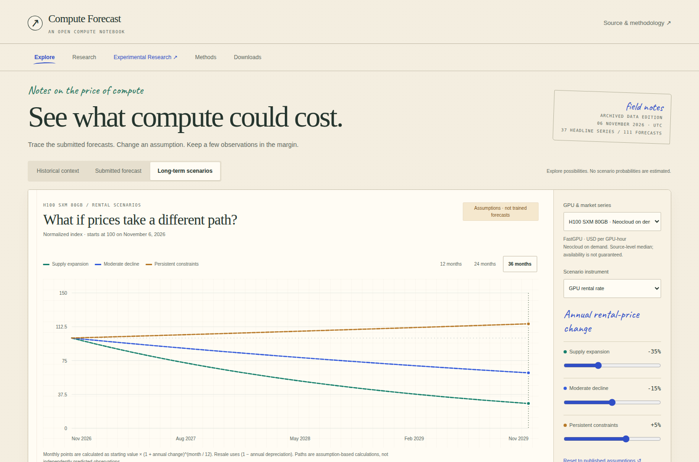

# Compute Forecast

**A GPU pricing notebook with reproducible forecasting experiments.**

Explore advertised rental prices, inspect an archived forecast, and see how explicit assumptions change longer-term pricing paths. The research atlas connects saved model checkpoints, forecast scores, uncertainty, and actual experiment-selection decisions.

[Explore the notebook](https://howdymary--compute-forecast-observatory-web.us-east.modal.run) · [Research atlas](https://howdymary--compute-forecast-observatory-web.us-east.modal.run/#research) · [Results and downloads](results/README.md) · [Methods](docs/README.md)

*Assumption-based scenarios, starting at index 100. These paths are calculations, not trained forecasts or confidence intervals. Screenshots come from the verified deployed application.*

## What you can explore

- **Historical context.** Independently licensed A100 40GB and T4 hyperscaler-spot series: 234 observed dates each, January 12–November 6, 2026, with 65 missing calendar dates. Gaps remain visible. This context failed the strict numerical-identity check against competition targets and is never stitched to their forecasts.
- **Archived benchmark forecasts.** The exact November 6, 2026 submission: 37 headline series, 111 rows, 1/3/7-day horizons, and q10/q50/q90. This is an archived forecast, not a live quote.
- **Long-term scenarios.** Separate 12/24/36-month rental and resale assumptions, explicit compounding, a time ruler, and immutable session pins. Dollar anchors are user-supplied assumptions.
- **Research results.** Actual checkpoint curves, matched controls, coverage versus interval width, paired action traces, and separate accounting for cached reveals, fresh executions, optimizer updates, time, and partial provider receipts.

## What the research found

The two policy studies have different evaluation scopes and must not be pooled.

| Study | Comparison | Pinball loss ↓ | Evaluation scope |
| --- | --- | ---: | --- |
| Frozen v1 | Starting policy | 0.01735406 | 30 cells across five dependent dates |
| Frozen v1 | Selected SFT policy | 0.01781945 | Same cells; **2.68% worse** |
| Expanded v2 | Starting selector | 0.01499533 | 12 eligible cells across three dependent dates |
| Expanded v2 | Development-selected operational SFT | 0.01156980 | Same cells; **22.84% lower** |
| Additional control | Fixed zero-shot Chronos-2 | 0.01211355 | Same 12 cells; additional retrospective comparison |

The expanded campaign completed **six SFT runs / 600 optimizer updates** and **three RL runs / 99 updates**. All three RL selections returned update zero, their frozen SFT parent: there was **no incremental RL gain**.

Feedback-hidden controls tie in forecast loss in five of six SFT runs. Some tied runs nevertheless change their action sequences. Changed behaviour and improved forecasting are separate questions.

The policy evaluations and retrospective Chronos control cover **A100 series only**. They do not establish H100 policy performance or general research intelligence. V2 reuses previously inspected dates; its improvement is not an untouched or prospective result. Three dependent dates do not establish population calibration.

[Full campaign findings](docs/campaign-v2-findings.md) · [Frozen v1 representation findings](docs/representation-findings.md) · [Chronos control and publication audit](docs/research-explorer-v3.md)

## Inspect the evidence without credentials

The [results directory](results/README.md) contains versioned, hash-indexed snapshots of the official forecast, numerical summaries, checkpoints, paired traces, contextual history, and scenario assumptions. Raw competition offers, restricted source excerpts, private model paths, and credentials are excluded.

- [Official forecast CSV](results/frozen-v1/forecasts.csv)
- [Expanded campaign results](results/expanded-v2/summary.json)
- [Chronos-2 control and future commitment](results/explorer-v3/chronos-control.json)
- [Historical context, permissions, and paired traces](results/explorer-v3/history-and-traces.json)
- [Artifact checksums and provenance](results/manifest.json)

A separate **14-series / 42-row prospective commitment** targets November 16, 18, and 22, 2026. Outcomes remain pending. The locked evaluator cannot score before November 23 UTC and additionally requires verified compatible outcome data. Both comparators use the same stale November 6 snapshot.

## Reproduce and validate

The interface uses HTML, CSS, JavaScript, and SVG, served by FastAPI on Modal. Numerical tools score forecasts deterministically; a Tinker-trained Qwen policy selects bounded experiment configurations. Exa and past.dev support a separate evidence-and-criticism loop.

1. Start with the [reproduction guide](docs/campaign-v2-reproduction.md) and [frozen v1 protocol](docs/protocol.md).
2. Numerical reruns require authorized access to the source pack. Training additionally requires Tinker access; saved private checkpoints are not bundled here.
3. Configure the documented GitHub Actions secrets and use the remote workflows on `compute-observatory`. The workflows verify source hashes, archive manifests, cutoffs, and output contracts.
4. Audit the committed snapshots without accounts, or reproduce recorded decisions from the [derived research archive](https://howdymary--compute-forecast-observatory-web.us-east.modal.run/experimental/downloads/43677783872.zip). New training is stochastic and should receive its own run identity.

The current code passed **105 tests**, with one existing optional dependency skip. [Pricing](https://github.com/howdymary/compute-forecasting/actions/runs/43691563096), [experimental](https://github.com/howdymary/compute-forecasting/actions/runs/43691563062), [notebook](https://github.com/howdymary/compute-forecasting/actions/runs/43691563067), and [research-explorer](https://github.com/howdymary/compute-forecasting/actions/runs/43691563100) UI checks passed. Desktop and mobile PNGs were inspected at 1512, 390, and 320 pixels. Stress checks retained eight simultaneous callers, exact numerical assertions, and zero automatic retries.

## Repository guide

| Directory | Contents |
| --- | --- |
| [src/compute_forecast](src/compute_forecast) | Forecasting, policy training, evaluation, publication, and interface code |
| [configs](configs) | Registered experiments, immutable selection boundaries, and model revisions |
| [results](results/README.md) | Public numerical snapshots, forecast exports, and provenance |
| [docs](docs/README.md) | Methods, findings, related work, data definitions, and reproduction guides |
| [tests](tests) | Cutoff, scoring, publication, and contract checks |
| [.github/workflows](.github/workflows) | Remote experiments, validation, artifact publication, and deployment |

## Sources and reuse

The data measures **advertised rental offers**, not transactions, guaranteed capacity, or physical GPU resale prices. Provider/configuration normalization has established precedents, including [Silicon Data](https://www.silicondata.com/products/silicon-index) and [SemiAnalysis](https://semianalysis.com/gpu-pricing-index/).

Independent historical context is derived from [Alex Hubbard's GPU Price Tracker](https://github.com/alex-hubbard/gpu_price_tracker) under its explicit CC BY 4.0 data license. Competition-compilation history remains unpublished because its redistribution permission is unresolved. Model, library, and data licenses apply independently; see [sources and publication rights](docs/DATA_SOURCES.md) and [attribution](NOTICE.md).

For citation metadata, see [CITATION.cff](CITATION.cff).
