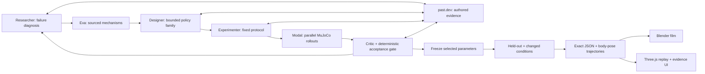

# System architecture

Physics: 500 Hz; control: 50 Hz; recorded poses: 25 Hz. The fixed torso and
legs support a three-joint right arm. Inverse kinematics maps a desired contact
position to bounded actuator position targets. Arm gravity compensation is
applied as generalized forces. There are no puck pose writes after reset.

Observation: joint positions/velocities, hand pose, puck position, and goal.
Action: three actuator position targets. Servo gains and force limits live in
the fixed simulator, not in the candidate-editing interface.

Policies vary approach offset, push velocity, contact height, stopping distance
and optional object-pose feedback. The finite episode horizon is six seconds.
Target radius is 2.8 cm, with a 0.5 s dwell and terminal persistence requirement.
The table-boundary and finite-state checks can invalidate success. Joint ranges
and actuator-force bounds are enforced by MuJoCo.

The live loop evaluates 6 candidates × 8 development seeds (48 simulations),
compared with a conventional 6 × 8 random-search control. Baseline and final
evaluation simulations are counted separately. The local preview has a different
12-candidate budget and is explicitly labeled as conventional search.

The critic's model recommendation is necessary but not sufficient for accepting
a challenger: success count must improve, or tie with lower mean final distance.
Numerical results are authoritative. This is a bounded, model-driven research
workflow, not unconstrained autonomous code invention or neural policy training.

Past.dev recall must return a required source ID before an exact numerical
payload is consumed. Local artifact maps preserve exact values and hashes;
the remote recall gates access and records cross-agent provenance. This hybrid
design does not prove memory improves results. The private synthetic canary is
read by the critic and must not be returned to the researcher.

Simulation, rendering, and presentation are decoupled. Blender and Three.js use
the same absolute body transforms and wxyz quaternions. Material, face, light,
and camera changes are cosmetic. The puck collision shape is a cylinder with a
decorative star stamp. Self/arm-table collisions other than the spherical hand
are disabled: this is an important limitation, not a whole-body safety model.

The web viewer is a recorded replay. Live research is initiated by an explicit
workflow run, not a browser button. No provider credentials reach the browser.
