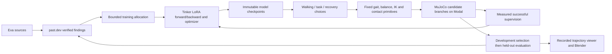

# Walking, manipulation and arm-recovery post-training

V8 resumes the retained V7 update-96 Qwen3.5-4B LoRA state. It trains repeated observed-state walking commands, four contact-profile choices, and post-task active-arm recovery. The Unitree gait network, standing controller, arm IK solver, simulator and object properties remain fixed. This is decision-policy learning rather than learning motor torques or gait-network weights.

The laptop fix is an engineered upper-edge force-controlled press from a front-right stance. The previous shallow position-step press produced insufficient sustained closing torque. Contact moves the actual hinged lid; the verifier still requires a lid angle below five degrees, low speed, contact-driven progress and release dwell. No lid pose or hinge property is changed to produce success.

Recovery has four actual actuator-control choices: direct fold, clearance withdrawal, the older parking detour, and delayed direct fold. The alarm clearance motion moves the shoulder outward before lowering, avoiding the clock housing. Other tasks can use a direct fold when it is safe. Recovery requires a stable rest pose, low joint speed, no fall and no fixture-contact steps above 0.01 N. Joint travel, hand path, duration and contacts are retained, including failures.

The new route keeps the first two V1 legs and uses a manually specified, swept-clearance-checked corridor to the laptop and globe. It is not a globally optimal route. The 10 mm planning allowance is an engineering allowance, not a proven tracking guarantee.

## Frozen comparisons

- Original V7 weights and original stack: engineering reference.
- Original V7 weights and frozen V8 stack: the actual pre-training baseline.
- Development-selected V8 weights and that identical stack: weight-training comparison.
- Fixed waypoint and task/recovery choices: conventional baseline, chosen using training evidence only.

Training uses seeds 23000–23007. Development uses 24000–24001. The final test uses 25000–25003 only after checkpoint selection. The 19000-series was used to engineer the fix and is not a held-out test. Each checkpoint replay is its own uninterrupted physical episode. All regressions remain visible. Additional updates are counted separately from the 96 parent updates.

Modal branches candidate task/recovery controls from recorded physical states. A fixed geometry follower supplies walking labels. Only successful physical task/recovery candidates supply supervision. Numerical integration state is saved with actuator mode and parameters; state-restoration tests bound reconstruction differences. Exact equality of every derived MuJoCo solver field is not assumed.

Tinker performs six forward/backward calls and one optimizer step per update. All six domains receive gradients. Recovery sampling is balanced across the four tasks. Repeated examples are reported as repeated training, not new physical evidence. Full optimizer states are retained at updates 8, 16, 32 and 64; update zero reuses the parent state. No checkpoint deletion or billing-plan change is part of this study.

Exa searches and source-verified past.dev handoffs occur at initialization and update 16. Recalled proposals choose between two predeclared equal-size training allocations. These services inform the outer research loop; neither is called at the physics timestep. The critic qualifies findings and a private-audience canary checks access isolation. No causal benefit from search or memory is claimed without an ablation.

## Run

From the repository root, with the existing backend provider credentials:

```sh
PYTHONPATH=mochi/src python -m pytest mochi/tests/test_control_v8.py -q
PYTHONPATH=mochi/src python -m mochi.control_v8.train
```

Live numerical progress: https://howdymary--mochi-control-v8-monitor-status.us-east.modal.run/

The additive workflow is `.github/workflows/mochi-control-v8.yml`. Configuration and split/selection rules are in `mochi/configs/control-v8-protocol.json`. Exact outputs, trajectories, unsuccessful branches and private model-state references go to ignored `mochi/artifacts/control-v8/`. Public exports must omit private state paths and credentials.

## Engineering calibration

On calibration seed 19001, fixed controls completed all four tasks, all four arrival checks and all four recoveries, without falling. This establishes a working vertical slice before training. It does not establish learned improvement. Isolated laptop calibration seeds 19000 and 19001 also closed the lid through contact.

## Completed source study · November 18, 2026

Run 44382265039 completed successfully: 64 additional Tinker optimizer updates, 384 completed domain-gradient calls and 5,120 consumed examples including repetitions. The eight training seeds supplied 1,055 unique labeled observations. Development selected update 8; updates 16, 32 and 64 did not improve full-sequence completion. All five checkpoints are retained.

On the four previously withheld 25000-series scenarios, the selected weights completed 4/4 continuous sequences, reached 16/16 stations and passed 16/16 arm recoveries, with zero falls and zero recovery fixture-contact steps. The parent weights reached 0/16 stations through the new V8 interface. The conventional controller also completed 4/4 sequences. Mean simulated completion time was 75.79 seconds for the selected model and 90.35 seconds for the conventional controller; inference waiting time is excluded.

These are four fixed-layout simulation cases from one training run, not a general robotics benchmark. The 95% Wilson interval for 4/4 completion is approximately 51–100%. The original V7 stack remains a separate reference. Numerical outcomes are in [the source evidence](../evidence/control-v8/results.json), and the later laptop-clearance study is reported separately.

## Isolated control checks

Separate task and arm-recovery probes use the original source test seeds 25000–25003 after immutable checkpoint selection. These are diagnostics on the same four scenario parameters, not four additional independent full-route tests. Navigation failure must not hide the quality of those decisions. Before/after task choices share an initial fixture state. Recovery choices share a post-task state produced by the predeclared B/A/P1/A engineering controls. If that reference task fails, the recovery pair is unavailable and counted as such. These resets belong only to isolated tests; the primary demo remains one continuous four-task episode. The additional batch is bounded at 80 physical rollouts and stays within the 512-rollout cap, including the separately recorded rejected revision. No resulting outcomes may select training checkpoints.

The wider-stance/XY-force engineering candidate was stopped after update 8 regressed from 1/2 to 0/2 development completions. It was not promoted, and its fresh 26000-series tests stayed unopened. [The rejection record](../evidence/control-v8-clearance/rejection.json) preserves the observed failure; it is not presented as a completed frozen study or evidence that every checkpoint would fail.

The completed [probe run 44402967613](https://github.com/howdymary/mochi-demo/actions/runs/44402967613) executed 80 physical rollouts with zero optimizer updates. Both starting and selected models passed 4/4 isolated tests for each task. On shared post-task states, recovery improved from 12/16 to 16/16 valid attempts, and fixture-contact steps decreased from 1,481 to zero. The parent selected direct folding beside the alarm; the trained model selected outward clearance in all four alarm states. The primary full-route tests remain 4/4 selected versus 0/4 parent and 4/4 fixed control.

Among the 12 shared states where both models recovered safely, mean hand travel was 9.33 cm before and 9.28 cm after. This does not establish a substantial learned reduction in hand travel. The much larger 19.6-to-9.3 cm reduction in the [recovery-design audit](../evidence/control-v8/recovery-design-audit.json) compares engineered options on 22 valid paired training states; it is not a learned held-out gain. Recovery safety, motion length and task success are reported separately in [the probe evidence](../evidence/control-v8/isolated-controls.json).

The source study and probes account for 335 completed physical rollouts. The rejected revision separately reported four completed development rollouts at cancellation, with other in-flight work unconfirmed; those attempts are not credited as successful executions. A duplicate probe launch, run 44402969230, was canceled during installation before its model-evaluation step. Canonical training states were preserved throughout.

Final memory receipts are read from the completed `progress.json`: the original runner saved `report.json` just before its last service-receipt refresh. The exporter checks identical source identity, selected checkpoint and measured performance before joining those final receipts. It records both file hashes and leaves the downloaded archive unchanged. The finalized source record has ten verified cross-role memory handoffs.

## Timing and deployment limits

The selector runs between bounded simulation actions. MuJoCo time pauses while remote model inference is pending; the fast native gait, balance and arm feedback execute inside each action. Completion time is simulated physical time, not real-time inference throughput. Worker wall time and actual Tinker inference calls are retained separately. This is not a real-time hardware control or sim-to-real demonstration.

## Execution architecture



The data-capture phase generated eight physical behavior episodes and their counterfactual branches. Supervision was subsequently relabeled from those same measured branches: lower-force successful task controls and minimum-travel safe recovery. The stored behavior trajectories do not pretend to follow those new labels. They supply visited physical states; every alternative label has an actual experiment from the same state. The new checkpoint-selection rule was frozen before optimizer updates or held-out evaluation.

The new scenarios draw initial robot position/yaw and fixture stroke, spring, mass, friction and starting angle from the existing parameter ranges. The desk layout and object locations stay fixed. This is not a test on unseen room or desk layouts.

## Run provenance

The physical-label collection run was [44378183870](https://github.com/howdymary/mochi-demo/actions/runs/44378183870): 229 completed rollouts, seven valid full behavior sequences from eight training seeds, and zero optimizer updates. It was stopped before completing the baseline evaluation to correct the objective. A label-preparation attempt, [44381735488](https://github.com/howdymary/mochi-demo/actions/runs/44381735488), was stopped before weight updates to align checkpoint selection with the same motion objective. Both artifacts remain retained. The final training source is `7836634e434bb0b2c8f600afeb4847b7cf00b684`, [run 44382265039](https://github.com/howdymary/mochi-demo/actions/runs/44382265039). The initial checkpoint lookup preflight, run44377705298, performed no training or physical rollout.

V7 used a different observation representation and navigation tolerance. The V8 baseline retests its weights through the V8 interface. Its result is not a claim that V7 failed its original task; the original-stack reference is reported separately. The weight comparison measures learning given the engineered V8 inputs and primitives.

## Presentation rule

For the public walkthrough, the first successful held-out seed (in declared order) opens as a synchronized before/after example, explicitly labeled as selected after evaluation. The full four-case success rate and every attempt remain available. If no held-out sequence completes, the viewer opens the first development seed. Checkpoint comparison initially uses the first declared development seed. This default rule was declared before the held-out tests; it changes presentation, not model selection or the reported cohort.

The viewer subsequently added a selector for both development scenarios. Scenario 24001 shows complete sequences from update 8 onward; scenario 24000 retains the laptop failure. The displayed development completion rate remains 1/2. Choosing a walkthrough scenario does not change the selected model or evaluation result.
