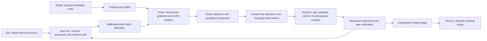

# Walking and four-task post-training

The approved study trains one Qwen3.5-4B LoRA model using Tinker. It observes relative position, heading, motion and body tilt to choose walking velocity commands repeatedly. At each object it observes the task state and chooses a contact-control profile. Twelve leg joints, fourteen arm joints and the six-degree-of-freedom base remain simulated. The waist and fingers retain a rigid pose. This is command-level locomotion learning and contact-profile learning, not learning motor torques from scratch.

## Fixed foundation

The gait is the official Unitree `unitree_rl_gym` 12-leg policy, revision `276801e46c5d433564f24658bac64f254b7d2d4b`, BSD-3-Clause. `assets/robot/locomotion/source.json` pins every downloaded file. Miniature similarity scaling changes length by s, mass by s³, inertia by s⁵, torque by s⁴ and time by √s. A velocity-feedback wrapper, a classical standing joint servo and arm inverse kinematics are shared by every checkpoint. Miniature actuator settings are engineering calibration, not manufacturer-validated hardware parameters.

The Menagerie G1 body is 22.1 cm high. Only actuators move it during episodes. MuJoCo controls the free base, feet and passive objects. Reset poses are assigned only when an episode starts. The task order is alarm button press/release, drawer close, laptop **close**, and globe marker alignment. The same clock and complete physics state persist between stations. The hand withdraws above the fixture before folding for transit. Blender/Three.js replay measured body transforms; they never animate task outcomes independently.

## Training and evaluation

`configs/curriculum-protocol.json` fixes training/development/test seeds, limits and selection criteria before post-training. Task examples come from actual policy-by-scenario trials on Modal. Walking examples come from the fixed waypoint controller. The model receives no seed, hidden mass/friction, teacher labels or evaluation outcomes. Visible manufacturer/material categories indicate a range of possible physical parameters.

Tinker receives separate `forward_backward(..., loss_fn="cross_entropy")` calls for walking, alarm, drawer, laptop and globe before each `optim_step`. The report records actual per-domain losses, examples, completed optimizer calls, and saved optimizer/sampling checkpoints at updates 0, 8, 16, 32 and 64. Each development checkpoint executes closed-loop decisions in one uninterrupted episode. Held-out scenarios remain unused until a development checkpoint is selected. Failures and regressions remain in the evidence.

The hand-force validity ceiling is 0.8 N, approximately half the miniature robot's weight; tilt must stay below 30°. These are simulation-study constraints, not a hardware safety certification. Contact-profile backoff thresholds are controller parameters, not guarantees that instantaneous force stays below them. Task success also requires hand contact, release, low object speed and a dwell. A laptop that drifts closed without contact does not count.

Modal runs the contact experiments and independently replays the complete closed-loop action transcripts generated during evaluation. The runner deliberately avoids assuming container affinity across separate calls. Local and remote task outcomes and episode duration must agree. Eight CPU workers, at most 64 updates and fewer than 3,000 total rollouts bound the pilot.

## Sponsor integrations

- **Tinker:** `src/mochi/curriculum/train.py` contains actual LoRA forward/backward and optimizer calls for all five domains; `decisions.py` defines the trainable interface.
- **Modal:** `src/mochi/curriculum/remote.py` runs real physical trials, fixed-controller episodes and full action-transcript verification.
- **Exa:** failure-derived searches run before training and at selected development checkpoints. Retrieved sources and observed bottlenecks inform the next training allocation. This does not by itself establish a causal search benefit.
- **past.dev:** separately identified research, design, execution and criticism roles write and recall sourced records. A recalled proposal changes the walking/contact batch allocation while retaining a 32-example total and examples from every domain. Source IDs must verify before numerical records are resolved. A private critic canary tests audience access isolation.

## Running

From the repository root:

```sh
python mochi/scripts/fetch_visual_models.py
PYTHONPATH=mochi/src mochi/.venv/bin/python -m mochi.curriculum.world --task all
PYTHONPATH=mochi/src mochi/.venv/bin/python -m pytest mochi/tests/test_curriculum.py
# With existing backend credentials, or through mochi-curriculum.yml:
PYTHONPATH=mochi/src mochi/.venv/bin/python -m mochi.curriculum.train
```

The additive GitHub workflow explicitly injects the existing Tinker, Modal, Exa and past.dev secret references. No credential enters the public interface. Artifacts belong to `mochi/artifacts/curriculum`. A configured service is not evidence of a completed run: inspect `report.json` and provider receipts before making performance claims.

## Data flow



The replay interface offers all five actual training checkpoints and a separate fresh-scenario comparison. It interpolates recorded body transforms by their true timestamps, with display-only decimal rounding. Stopped or failed episodes remain stopped. It does not splice successful task clips into an artificial continuous run.

The object bases are fixed benchmark fixtures: the button cap slides, the drawer slides, the laptop lid hinges and the globe rotates. The robot itself is unsupported. This simplifies object dynamics and does not represent arbitrary loose objects or real-world deployment.

Pre-training integration attempts are retained separately. The first completed service run retrieved Exa evidence and verified cross-role past.dev recalls, but its Modal trials failed while resolving a native asset path. It completed zero optimizer updates. The fix supplies an explicit `MOCHI_ROOT=/app` inside workers rather than assuming Modal's automatic module mount preserves the checkout layout.

Before optimizer updates, the final engineering revision adds actual loaded-foot contacts and the last two walking commands to the model observation, plus arrival error and an estimated loaded-contact slip distance. The laptop arm first lifts outside the lid's edge before approaching its contact point. A complete manually selected calibration sequence passed all four tasks, with no reset or fall. This establishes physical feasibility; it is not a learned-policy result. Starting and trained weights share this revised foundation.

Completed earlier alarm, drawer and globe contact trials can be reused because their dynamics and controllers are unchanged. Earlier laptop trials remain archived and are superseded by fresh trials using the corrected approach. The report records source run IDs, dataset hashes, reused rows, regenerated rows and all completed physical trial counts. Held-out scenarios remain unused until model selection.
