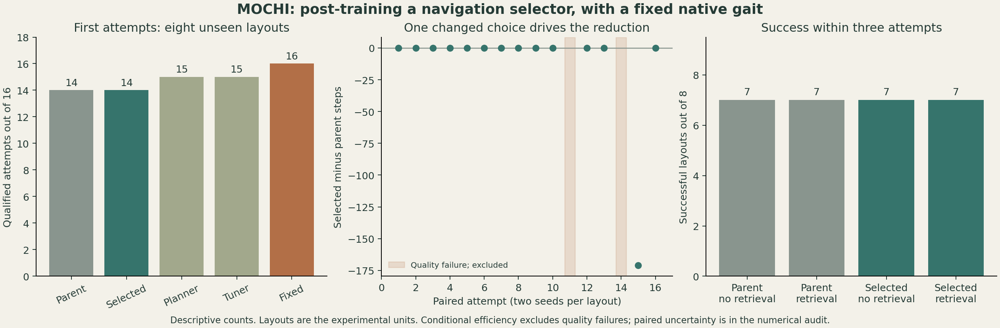

# Navigation decisions across unseen cluttered desks

Study completed November 21, 2026. Experiment `mochi-nav23-20261121c`.

[Paired physical replay](https://howdymary--mochi-navigation-v23-demo-web.us-east.modal.run/) · [Full numerical results](../evidence/navigation-v23/results.json) · [Methods](navigation-v23-methods.md) · [Frozen protocol](navigation-v23-protocol.md)

## What happened

Tinker completed 15 optimizer updates on a rank-16 Qwen3.5-4B LoRA adapter that chooses a route and walking-controller profile. The selected checkpoint passed 14 of 16 attempts on eight unseen layouts. The parent also passed 14; the strongest fixed strategy passed all 16. This study does not establish improved navigation reliability over its controls.

All sixteen parent and selected attempts reached their goals without a fall or forbidden contact. Two attempts in each cohort missed the frozen moving-foot-clearance requirement. Arrival and qualification are different outcomes. Each layout has two physics seeds; these are eight layouts, not sixteen independent environments.

| Method | Within all constraints | Arrived | Falls | Forbidden contacts |
| --- | ---: | ---: | ---: | ---: |
| Untrained navigation parent | 14/16 | 16/16 | 0 | 0 |
| Selected update 4 | 14/16 | 16/16 | 0 | 0 |
| Collision-aware planner | 15/16 | 16/16 | 0 | 0 |
| Conventional tuning | 15/16 | 16/16 | 0 | 0 |
| Strongest fixed strategy | 16/16 | 16/16 | 0 | 0 |
| Selected + training memory | 14/16 | 16/16 | 0 | 0 |

Training changed only one of sixteen final profile choices. On that case, parent buffered control used 512 steps and 67.56 physical seconds; selected direct control used 341 steps and 47.52 seconds. Both qualified. The other fifteen choices were unchanged. Across the fourteen jointly qualified attempts, aggregate mean steps fell about 5% and mean completion time about 4%; that entire aggregate gain came from the one changed case. The viewer labels this post-evaluation highlight and retains the complete cohort and stronger controls.

The paired layout bootstrap and raw counts are in [the numerical audit](../evidence/navigation-v23/paired-audit.json). Conditional efficiency excludes failed quality checks. A bootstrap interval of zero for identical observed success differences cannot establish equivalence in other environments. Eight generated layouts provide limited uncertainty resolution.

## What was trained

The model receives exact obstacle geometry, target pose and feasible A* candidates, then chooses direct, buffered or careful control before an attempt. These profiles couple margin, speed and turn rate. A validated high-frequency controller executes through MuJoCo joint actuators. The free base receives no applied support force. The native G1 gait network is fixed.

Each training iteration uses a different generated layout and three measured candidate outcomes. Fifteen supervised targets comprised fourteen direct and one buffered choice. Real forward/backward and optimizer receipts, losses, saved optimizer states and probes are retained. Checkpoints 0, 4, 8 and 15 were physically compared on the same eight development layouts with two seeds. Development selection chose update 4 before opening final layouts. All four checkpoints qualified on 16/16 development attempts; the selected checkpoint's mean step count was 216.19 versus the parent's 216.56.

A separate exported-tensor audit found 498 changed adapter tensors, with maximum absolute parameter difference 0.0004002919. Optimizer receipts and tensor differences verify the weight updates. Physical evaluation determines whether they helped. Unrounded trajectory, control, footstep and balance records matched the parent on 12/16 selected attempts and the strongest fixed strategy on 0/16. This is a finite-recording audit rather than general policy equivalence.

The selected model chose direct on all sixteen final attempts. Different obstacle layouts still produce different A* routes under a fixed profile. Those route changes belong to the shared planner. The requested transferable learned rule, leaving more room before turning near an obstacle, was not established. The separate mug-in-turn diagnostic distinguishes profile changes, planner rerouting and physical outcomes. It is exploratory and development-derived, not an additional held-out cohort.

Across the four variants in two counterfactual pairs, parent and selected qualified on 3/4 and 3/4, while the planner qualified on 4/4. In the first pair, moving the mug caused both model-controlled attempts to miss the foot-clearance check; the planner still qualified. The selected model kept the same profile in both pairs, while its A* routes changed. These observations do not demonstrate a learned turning-clearance rule. [Counterfactual evidence](../evidence/navigation-v23/counterfactual-results.json).

## Shared memory and retries

First-attempt selected qualification was 14/16 both with and without a frozen training-memory retrieval. For adaptation, each of the eight layouts used one matched physics seed and at most three attempts. Both conditions retained all previous local failures in working context; retrieval additionally supplied the training prior and source-verified case evidence. This tests incremental retrieval, not memory against complete amnesia.

| Condition | First success | Success within three | Total attempts | All steps | All physical seconds |
| --- | ---: | ---: | ---: | ---: | ---: |
| parent no memory | 7/8 | 7/8 | 10 | 2769 | 371.98 |
| parent memory | 7/8 | 7/8 | 10 | 2643 | 357.73 |
| selected no memory | 7/8 | 7/8 | 10 | 2598 | 351.94 |
| selected memory | 7/8 | 7/8 | 10 | 2598 | 351.94 |

With the selected weights, success within three attempts was 7/8 without retrieval and 7/8 with retrieval. With the parent, the corresponding counts were 7/8 and 7/8. These are observed counts in eight layouts, with uncertainty reported in the paired audit; they do not establish a general adaptation advantage.

Every reset and failed attempt is included in these costs. First recordings reused from the primary cohort are not billed twice. Paired layout intervals are reported separately for training and memory effects. A retrieval receipt is not evidence of better adaptation.

Four application roles performed real writes and reads through past.dev. The report retains 14 verified cross-role recalls and 5 denied-source checks. The private critic canary and case-local reader restrictions were enforced through explicit identities and audiences. Dependent reads waited for completed ingestion. The initial training record was frozen before final execution, and each retry case had its own restricted audience.

The shared provider project can return unrelated public records. Only the exact requested source is admitted to the model after verifying its returned source ID; unrelated text is excluded. Public receipts withhold unrelated source identifiers while retaining counts and hashes. Exact-source verification controls model input; the private-audience checks verify access separately.

## Service use and accounting

Exa searched measured final-heading oscillation. Sourced mechanisms and a cross-role recalled decision changed the replay allocation toward balanced evidence. The controller's earlier phase-latching repair was manually engineered and shared across all compared methods; later search is not credited with inventing that repair. Search was not ablated, so this study does not isolate its performance benefit.

Modal ran parallel physical candidates, development and final cohorts, retries and counterfactual tests. Tinker trained the navigation adapter, restored saved checkpoints for sampling and exported tensors for inspection. past.dev handled actual ingestion, recall, authorship and access checks. The public viewer is recorded simulation and makes no sponsor API calls.

The combined ledger reports 278 actual physical attempts and 7.683 conservatively accounted simulation wall-hours. It retains nine never-dispatched rollout reservations, so its charged rollout count is 287. The pilot used fifteen new optimizer updates plus one earlier interrupted, unpromoted update, within its sixteen-update ceiling. Training-token presentations: 593,924; inference input plus reserved output: 470,031. Exa requests: 3; memory ingestions: 23; actual recall requests: 27. The modeled provider total of $9.39 is a budget estimate, not an invoice or a claim about billed credits.

The orchestrator was cancelled during retry evaluation after training and first-attempt evaluation had completed. Continuations preserved a hash of all frozen numerical fields, recovered one already-completed child without rerunning it, repaired read-journal restoration, and restored optimizer weights correctly for sampling. They added no optimizer updates. Original interruption and continuation receipts remain in the report.

## The four-task extension

The navigation development gate passed, so a separate object-relative task preflight ran. Its closed twelve-attempt pilot physically completed books, clock, drawer and laptop in the strongest uninterrupted prefix, then contacted the globe. Three additional bounded departure probes did not validate the transition. No task optimizer update was launched. The eight final sequence layouts remain unopened.

The extension found and separately repaired initialization after MuJoCo constant rebuilding and a stapler intersecting the relocated laptop's lid sweep. Those changes are not retroactively credited to the frozen navigation comparison. Five full physical prefixes are available on the separate task-preflight page. Component branches are not spliced into a continuous success. [Task findings](navigation-tasks-v24-findings.md).

## Scope and next experiment

This is state-based navigation with privileged geometry in generated cluttered desk layouts. It does not demonstrate perception, unstructured-world navigation, native gait learning, book-height generalization or reliable four-task transfer. Printed route overlays use an approximate neutral collision envelope; actual contact measurements determine failure. The first Phase A scene reset also restored some sampled fixture and joint coordinates to model defaults. All frozen comparisons share those measured initial states; Phase A does not validate intended sampled openings or manipulation readiness.

The next study should fix whole-body task approach feasibility before more task training, decouple clearance choice from speed, collect more informative turning cases, and compare a learned margin rule with a strong contextual tuner. It needs new unopened final layouts because this final cohort is now closed to tuning.

## past.dev challenge

Agents: failure analysis, policy design, physical execution and evaluation used distinct model instructions, authors and explicit readers. More than one role wrote and read; verified cross-role recall influenced the replay decision and subsequent review.

Layers: working prompts held temporary context; past.dev held sourced hypotheses, observations and qualified conclusions; versioned code held procedures; the isolated artifact volume held exact numerical records and trajectories.

Results: actual ingestion, recall, source verification, denied-source tests and per-case isolation are retained alongside the paired memory experiment. Numerical adaptation results above determine the memory claim.

Caveats: the two conditions share local failure information, and the retrieval prior may add little beyond it. This small study cannot establish a general memory benefit. Unrelated public results were filtered at the source gate, rather than silently included in prompts.

## Inspect and reproduce

[Methods and commands](navigation-v23-methods.md) · [Integration paths](navigation-v23-integrations.md) · [Checkpoint receipts](../evidence/navigation-v23/checkpoint-receipts.json) · [Recording manifest](../evidence/navigation-v23/recording-manifest.json) · [Tensor audit](../evidence/navigation-v23/weight-tensor-audit.json) · [Trajectory audit](../evidence/navigation-v23/trajectory-equivalence-audit.json)

Training and evaluation are in `src/mochi/navigation_v23/campaign.py`; authenticated services in `services.py`; CPU batches in `remote.py`; physical verification in `engine.py`; collision-aware planning in `planner.py`. Existing apps and archived results are preserved. Reproduction must use a new experiment identity and final set, rather than overwrite this archive.

## Release verification

The hosted application was built from published Git commit `e7d85dcf4f1744c3a44f8ec93861addf80b7f1fb`. All 238 downloadable recordings, totalling 747,248,615 bytes, and 46 frontend or asset files matched their source hashes. The complete local browser pass covered 144 available comparisons across sixteen development and final layouts; hosted checks covered four representative comparisons and all five task-preflight recordings. Rendered body positions matched the exported trajectory coordinates. The separate V21 and V22 apps remained healthy, and all 339 earlier files plus 231 frozen study files remained unchanged.

[Hosted integrity checks](../evidence/navigation-v23/live-verification.json) · [All local comparisons](../evidence/navigation-v23/browser-qa-local.json) · [Hosted navigation](../evidence/navigation-v23/browser-qa.json) · [Hosted task preflight](../evidence/navigation-tasks-v24/browser-qa.json) · [Preservation checks](../evidence/navigation-v23/preservation.json) · [Release fingerprint](../evidence/navigation-v23/release.json)
