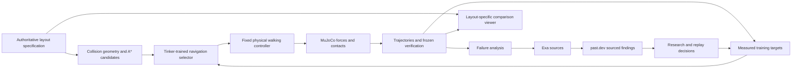

# State-based navigation across unseen cluttered desk layouts

The study asks whether post-training improves a navigation selector, and whether shared memory helps within three reset attempts. The selector receives exact state and chooses one complete route/controller profile. A fixed collision-aware planner produces the route candidates. A fixed actuator controller and native ONNX gait execute the choice in MuJoCo 3.3.7. Neither the physical root nor the feet are assigned animation paths.

## Scene and layout contract

`src/mochi/navigation_v23/layouts.py` creates meaningful printer, mug and station arrangements. The printer, tray and printout move together. Drawer and laptop pivots move with their assemblies. `world.py` applies static fixture transforms at time zero and verifies that robot mass, inertia, joint ranges, actuator gains and limits remain unchanged. Props and stations in the public replay come from that same scene specification and recorded body transforms.

The generator has four corridor families. Training and development use different sampled placements. Final navigation combines printer and mug families differently and adds a held-out final-heading combination. Sixteen training layouts, eight development layouts and eight unopened final navigation layouts are generated before selection. A separate eight-layout sequence cohort remains sealed until its gate is satisfied.

The static validator requires a feasible direct, buffered and planner route. It filters geometry, never policy performance. Every later execution failure stays in the cohort. The first final-generation specification closed one alternate corridor; its geometric rejection was retained and that specification was amended before sealing, training or final execution. This is a design correction, not performance-based removal of hard test cases.

Phase A is flat desk navigation. The books remain physical obstacles at their existing heights. This phase cannot support book-climbing, terrain-height generalization or perception claims.

## Collision-aware planning and execution

The planner derives obstacle world bounds from MuJoCo collision geometry. Its yaw-invariant neutral collision envelope includes the measured robot body and feet, plus a declared 12 mm swing/tracking allowance. This is a conservative planning abstraction, not an exact signed body-to-obstacle distance.

An eight-connected A* grid uses 10 mm spacing, forbids diagonal corner cuts, and checks simplified segments at 3 mm intervals. Extra margin and a clearance cost produce direct, buffered, careful and competent-planner routes. The geometry, candidate routes and required target heading are included in the observation. The model chooses one of the first three candidates before moving.

| Profile | Extra margin | Speed cap | Turn cap |
| --- | ---: | ---: | ---: |
| Direct | 4 mm | 0.100 m/s | 1.00 rad/s |
| Buffered | 16 mm | 0.075 m/s | 0.75 rad/s |
| Careful | 28 mm | 0.055 m/s | 0.60 rad/s |
| Planner baseline | 18 mm | 0.075 m/s | 0.75 rad/s |

The native gait, 6 mm bounded foot-lift reference, balance feedback and actuator limits are shared. The existing controller turns toward each segment, walks forward, stops at the waypoint and aligns to its outgoing heading. Each segment has a 45-second cap and the overall attempt a 120-second cap. These caps are part of the frozen controller contract. A route can therefore be geometrically feasible yet fail dynamically or time out.

Margins and speed are coupled in this pilot. Improvement cannot be attributed to clearance alone without additional component controls. A constant selected profile can still produce different A* routes when geometry changes. Such rerouting belongs to the planner and is not evidence that the learned selector adapted its strategy.

The macro model receives robot-relative obstacle bounds, the relative target pose and candidate-route features. Joint state and contact feedback remain inside the fixed physical controller; they are not additional inputs to the once-per-attempt selector. There is no learned replan within an attempt or independent rescue planner. Continuous fixed balance corrections are shared across methods and are not instrumented as a separate discrete safety-override count. Failures, stops and planner decisions remain explicit. Loaded-foot sliding is the existing contact-based estimate, rather than external motion-capture ground truth.

## Training and controls

Tinker post-trains a fresh rank-16 Qwen3.5-4B LoRA navigation adapter. This creates an untrained navigation parent with the new observation/action contract, rather than treating an earlier four-task adapter as already competent in a different domain. Exact layout identifiers and split labels are excluded from observations.

Each iteration uses a fresh training layout and physically evaluates all three bounded actions. Qualified success outranks every failure. Among qualified outcomes, fewer measured steps lead, with distance and time breaking ties. The measured best action supplies a categorical cross-entropy target. Replay batches contain sixteen examples, with emphasis selected through the recorded research handoff. The total pilot ceiling is sixteen real forward/backward and optimizer steps. One interrupted update remains charged but unpromoted; the repaired comparison can perform fifteen further updates, saving parent, 4, 8 and 15 with optimizer state and evaluating them on the same development layouts. Unlabelled training failures are retained without inventing successful actions; the actual endpoint is saved if the bounded dataset is exhausted early.

The checkpoint is selected using development qualification first, steps on successful attempts second, and earlier update as the final tie-breaker. Final layouts are opened only after checkpoint selection, code, splits and training-only memory are frozen. No final outcome is used for training or checkpoint selection.

The competent planner executes its route physically. Conventional tuning fits a small contextual decision rule using exactly the same physical candidate outcomes as the learned method. A global fixed profile is selected from those training outcomes. Their shared interaction budget includes the learned method's data collection; neural optimization and inference are additional costs.

## Verification and analysis

Qualified arrival requires position error at most 12 mm, heading error at most 9 degrees, supported dwell, zero falls or invalid fixture contacts, roll RMS at most 2 degrees, peak roll at most 12 degrees, unsupported intervals at most 60 ms and measured moving-foot clearance at least 4.5 mm under the frozen estimator. The old whole-sequence acceleration average is not substituted for a short navigation verifier. Its raw telemetry remains available.

The primary outcome is qualified first-attempt success. Secondary measurements include all step attempts, physical time, measured pelvis travel, excess distance over the same feasible planner reference, nominal envelope clearance, heading, loaded-foot sliding, sway, arm travel, contact failures, latency and simulation resources. Raw pelvis travel includes gait sway. A negative nominal-circle clearance is not itself proof of physical contact; actual contact checks are reported separately.

Efficiency is compared only on pairs where both policies qualify. Layouts, rather than individual physics seeds, are the experimental units. The release script computes paired layout-level success differences and bootstrap intervals, retaining failures and acknowledging the limited precision of eight layouts. Repeated physics seeds do not create additional independent environments.

The separate counterfactual diagnostic moves a mug into a turn area while preserving the start and goal. Geometry-only filtering establishes a feasible alternative before inspecting trained checkpoints. It measures profile changes, planner rerouting and actual physical outcomes separately. These development-derived pairs are exploratory diagnostics, not additional unopened final layouts.

## Memory experiment

The primary parent/selected comparison disables retrieval. The separate first-attempt memory comparison uses the identical selected weights, controller, layouts and seeds, with a frozen training-only memory record. The viewer places selected-without-memory on the left for this comparison.

Adaptation allows up to three attempts per case. Both conditions retain all preceding failures in that case's working context. The retrieval condition additionally writes and recalls source-verified case evidence, as well as the training prior. This is an incremental retrieval comparison with overlapping information, not a test of memory against complete amnesia. The code passes only the requested canonical payload to the decision model after verifying the exact returned source ID; it does not silently substitute a local record when recall fails. Numerical arrays and trajectories stay in artifact storage.

Research, design, execution and evaluation have distinct identities. The initial private audience admits only the critic, and an unauthorized recall must not reveal its synthetic canary. Each retry case creates separate reader/writer identities and an audience restricted to those identities. A study-level reader must fail to retrieve each case-local failure record before the permitted case reader uses it. Source-gated data flow also prevents unrelated returned text from entering decisions.

Exa supplies sourced hypotheses in the working loop. past.dev carries the measured observations, sourced idea, replay-allocation decision, results and qualified verdict. Modal runs the real physics batches and backend integration calls. Tinker performs actual post-training. Service usage alone does not establish a performance benefit.

## Reproduction and inspection

Use the versions pinned in `src/mochi/navigation_v23/remote.py`. Existing credentials stay in saved backend secrets. Read `navigation-v23-integrations.md` before launching. A campaign refuses to overwrite existing progress. New reproduction needs a new run identity, new namespaces and a new unopened final set.

From the repository root:

```sh
python3.11 -m venv mochi/.venv-navigation-v23
mochi/.venv-navigation-v23/bin/pip install -r mochi/configs/navigation-v23-runtime.requirements.txt
mochi/.venv-navigation-v23/bin/pip install --no-deps -e mochi
mochi/.venv-navigation-v23/bin/python mochi/scripts/restore_navigation_v23_assets.py
```

Use that isolated environment in place of `mochi/.venv` below when starting from a fresh clone. The existing runtime used for this archived campaign is preserved. Upstream meshes and the native gait are restored only at the recorded revisions and verified by SHA-256. Existing files with different hashes are never overwritten.

```sh
PYTHONPATH=mochi/src mochi/.venv/bin/python mochi/scripts/seal_navigation_v23_layouts.py
PYTHONPATH=mochi/src mochi/.venv/bin/modal deploy mochi/src/mochi/navigation_v23/remote.py
PYTHONPATH=mochi/src mochi/.venv/bin/modal run mochi/src/mochi/navigation_v23/remote.py::launch
PYTHONPATH=mochi/src mochi/.venv/bin/python mochi/scripts/fetch_navigation_v23_results.py
PYTHONPATH=mochi/src mochi/.venv/bin/python mochi/scripts/build_navigation_v23_release.py --source mochi/artifacts/navigation-v23/completed
python3 -m http.server 4123 --directory mochi/web/desk
```

Open `http://localhost:4123/navigation-v23.html`. The public viewer replays recorded simulation and calls no sponsor APIs. Full unrounded trajectories live at the immutable `physics/` paths in the new Modal volume; their hashes accompany the public replays. Exact commands for a new campaign must change `RUN_ID` and upload its sealed layouts before launch. The archived published run must not be rerun in place.

The hosted viewer streams allowlisted, SHA-256-verified public recordings from a read-only mount of this run's `public/` subdirectory. Private checkpoints, memory payloads and raw backend state are outside that mount. Git contains the source and numerical evidence; the full recording cohort remains available through the published recording manifest without adding hundreds of megabytes to the repository.

The isolated task preflight later identified that `mj_setConst` restored fixture and leg coordinates to model defaults during Phase A scene setup. Phase A remains frozen: every compared method starts from the same measured defaults, including the closed drawer. The task extension repairs initialization separately and reruns its controls. Phase A navigation success cannot be presented as validation of manipulation, the intended sampled fixture openings, or that later engineering repair.

The first visible milestone is `evidence/navigation-v23/first-physical-route.png`, drawn from an actual qualified engineering rollout and collision bounds. It is labelled engineering, not a held-out learning result. The separate demo deployment preserves every earlier Mochi app.


