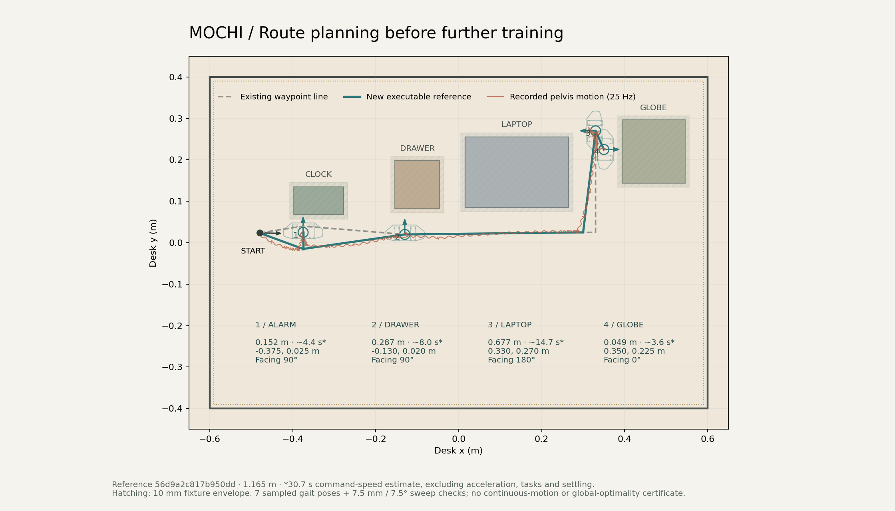

# Route planning before further training

This is a calibration study. It has not produced new Tinker controller weights.
The existing V7 model completed 96 optimizer updates; its native Unitree gait,
standing balance and arm IK were fixed. Those components remain fixed here.

The route is [structured control data](../configs/desk-route-v1.json), not a line
added to an animation. Its version is included in every tracking record and in
the replay. The robot moves through MuJoCo actuator control.



## What the diagnosis found

Previously inspected recordings contain about 2.0–2.1 m of pelvis motion for
roughly 1.1 m of waypoints. Pelvis distance includes gait sway. The old follower
starts aligning to a station's final direction within 70 mm, then translates
sideways or backward. This makes tracking and stopping worth investigating
before assuming a shorter global path will solve the problem.

The first new follower had its own failure: it could leave final alignment when
distance increased slightly, and stopping moved the pelvis another 5–14 mm.
Its failed local recordings remain in `artifacts/planning/`. The revised follower
latches final alignment, uses intermediate local targets and measures stopping
drift. These are fixed-control changes, not improvements learned by Tinker.

## Planning method and its limits

The SE(2) visibility graph searches a bounded set of corridor vertices. Edges
use the existing forward, backward and lateral commands; changes of body heading
are checked as in-place rotations. Nominal cost uses command speed and turning
rate. It excludes acceleration, settling, manipulation and arm recovery.

A detached MuJoCo planning copy enables the robot's visual mesh hulls and adds
per-part boxes from the actual clock GLB. It checks feet against desk bounds,
body/arm/foot configurations against fixtures, translations every 7.5 mm and
rotations every 7.5 degrees. Seven sampled native-gait configurations supply the
walking envelope. The original physics world is not edited.

The nominal 10 mm allowance comprises 2 mm geometric clearance, 5 mm tracking
allowance and 3 mm braking allowance. These are engineering assumptions, not
established bounds. Actual tracking errors must be reported beside them. Finite
sampling and convex/box envelopes do not certify continuous collision freedom.
Dynamic-obstruction replanning has not been demonstrated in this prototype.

The proposed reference is **1.165 m**, with a **30.7 s command-speed estimate**.
It takes a retreating route around the clock housing. It is longer than the old
waypoint line. Feasible arrivals and task access take priority over line length.
The claim is the best feasible result found on the chosen graph, not global
optimality or measured completion in 30.7 seconds.

## Contact feasibility is a separate gate

There were **80 real isolated Modal contact rollouts**, on calibration seeds
19000 and 19001. [All outcomes and execution identities](../evidence/planning/contact-calibration.json)
are retained.

The initial clock stance at y=0.015 m failed the firm-spring case with every
tested profile. At y=0.025 m, profile B passed both isolated cases. This is why
the new reference uses that approach. It is not evidence of general reliability.

All eight laptop profiles failed from the old nominal stance on those two seeds.
Thirty-two further tests of four nearby side approaches also failed to close it.
Additional local rear-approach and controller-reference probes did not establish
a reliable fix and were not promoted. The original world and controller source
were restored byte-for-byte before the paired study. Objects, native gait, IK,
collision rules and success verifiers remain unchanged.

The new fixed baseline uses laptop profile B because it avoided falls in the
isolated calibration. The old fixed baseline uses C. This is a combined
engineering comparison, not a clean route-only or model-weight ablation.
Reaching the laptop and touching its lid do not establish successful closure.
Do not generate an imitation label that calls an all-failure choice successful.

## What is measured

Four paired calibration scenarios use the same initial state on one Modal CPU
worker per pair. The primary presentation seed, 19000, was declared before the
paired results. The old route has five stops, including transit; the new route
has four task arrivals and tracks intermediate vertices without that extra stop.

Measurements include arrivals, tasks, full-sequence verification, walking time,
pelvis path, cross-track error, task-arrival error, reversals, torso motion, foot
slip and falls. Whole-route efficiency is qualified by completion. A short failed
episode does not receive an efficiency advantage.

The replay audit reconstructs generalized coordinates from recorded body poses,
checks forward-kinematics agreement, then measures conservative fixture overlap
and feet outside the desk at 25 Hz. This does not recover 1 kHz contact history.
Full-precision source episodes remain in the workflow artifact; web transforms
are rounded to six decimals for replay and linked by a source hash.

## Storage and the proposed training phase

[The read-only audit](../evidence/planning/storage-audit.json) found 100 checkpoints
and about 42.6 GB stored. Six checkpoints are Mochi full training states. No
checkpoints were deleted and billing was not changed.

Tinker's current documentation limits free storage to 100 checkpoints or 100 GB,
whichever comes first. Paid storage charges $0.10 per GB per month for all stored
data. Resume requires going below both free limits or enabling paid storage.
[Official storage documentation, checked 18 November 2026](https://tinker-docs.thinkingmachines.ai/administration/checkpoint-storage-pricing/).

The [proposed plan](../configs/path-training-plan.json) resumes the recoverable
96-update full state and caps the phase at 64 additional updates. Extra checkpoints
0/8/16/32/64 correspond to cumulative 96/104/112/128/160, not an untrained start.
Four new full states require about 1.75 GB and four available checkpoint slots.
V7 update 64 had better development arrivals than update 96, but only the latter
has a durable recoverable V7 optimizer state. Recoverability is not a claim that
the latest checkpoint is best.

Training must use physical supervision and include walking plus all four task
domains each update. Cache keys must cover every encoded input, including motion
state. The proposed comparison separates original weights/original route,
parent weights/new interface, trained weights/the same new interface, and fixed
control. Only the matched parent-versus-trained comparison isolates training.
Fresh 21000-series scenarios remain unopened. Selection uses development data.
This plan has not run; do not rerun the old refinement entrypoint as a substitute.

## Reproduce from the repository root

Use the existing Mochi environment and asset setup, then install the optional
plotting dependency:

```sh
uv pip install --python mochi/.venv/bin/python -e './mochi[dev,plots]' pyyaml==6.0.2
PYTHONPATH=mochi/src mochi/.venv/bin/python -m mochi.planning.route
PYTHONPATH=mochi/src mochi/.venv/bin/python -m mochi.planning.follower --seed 19000
mochi/.venv/bin/python mochi/scripts/draw_route.py
PYTHONPATH=mochi/src mochi/.venv/bin/python -m pytest -q mochi/tests/test_planning.py
```

The additive `mochi-planning*.yml` workflows inject existing backend secrets
explicitly. No credential enters the viewer. `mochi.planning.baseline` runs the
paired Modal study and source-verified Exa/past.dev handoffs. It performs zero
Tinker optimizer updates. Its Tinker calls are research-decision inference.

To inspect the view locally, serve `mochi/web/desk/` and open `planning.html`.
The page includes top-down, follow, side and foot views; a hideable reference;
synchronized old/new fixed-control playback; all calibration outcomes; and
service provenance. The existing checkpoint viewer remains `curriculum.html`.

```sh
/opt/homebrew/bin/blender -b -t 4 -P mochi/scripts/render_curriculum.py -- \
  --input mochi/artifacts/planning/episode.json \
  --out mochi/artifacts/planning/render --camera topdown \
  --route mochi/configs/desk-route-v1.json --time 30 --samples 32
```

The Blender overlay is an annotation. Robot and task motion come from the
recorded trajectory. No extra trained checkpoint or successful task is animated
into the demonstration.

## Paired calibration results

All four new episodes reached all four task stations without a fall. The old
method reached 17 of 20 stops and fell during three episodes. Both methods
completed zero full four-task sequences: laptop closure failed in all four
cases. The new method passed alarm, drawer and globe in all four cases.

The new stack also changes the laptop profile from C to B, so this result does
not isolate planning. It is not a model-weight comparison. On the only scenario
where both methods completed navigation, 19003, walking time increased from
47.1 to 52.6 seconds and pelvis path from 2.123 to 2.255 m. Task-arrival error
fell from 19.6 to 4.7 mm. It trades speed for precision and visual clearance;
there is no demonstrated efficiency gain yet.

The conservative replay audit found 79/61/56/67 walking frames with fixture
envelope overlap in the old episodes and zero in every new episode. It found
no feet outside the desk in either method. This is a sampled envelope test,
not proof of actual continuous collision freedom. New maximum cross-track
errors were 15.3–24.6 mm, exceeding the assumed 5 mm tracking allowance.
That assumption needs revision before promoting a safety claim.

The run made nine Modal rollouts, one Exa search, five past.dev writes including
the private canary, five recalls and four verified cross-identity recalls.
Four identities both wrote and read. The recalled design selected the executed
stopping probe. Two Tinker research-decision inference calls ran; controller
optimizer updates were zero. These counts are separate from the preceding
80 Modal contact calibrations and from the earlier V7 training study.

[Execution 44283374410](https://github.com/howdymary/mochi-demo/actions/runs/44283374410)
contains the full-precision source episodes and service receipts.
