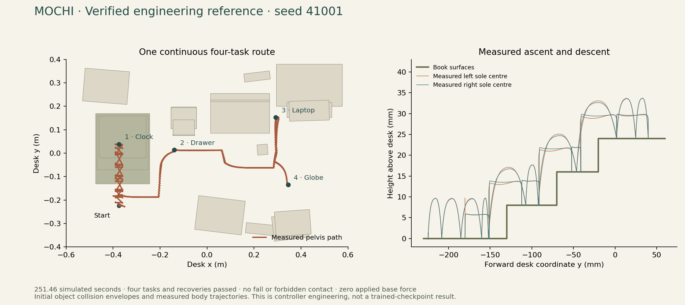

# Terrain V12: physical book traversal and control-policy post-training

[Continuous engineering demo](https://howdymary--mochi-curriculum-demo-web.us-east.modal.run/terrain.html) · [Live numerical training status](https://howdymary--mochi-curriculum-demo-web.us-east.modal.run/api/terrain-training) · [Active training execution](https://github.com/howdymary/mochi-demo/actions/runs/44472186998)

The strict controller completed the uninterrupted alarm-clock, drawer, laptop-close and globe sequence on local engineering seeds 41000 and 41001, in 249.81 and 251.46 simulated seconds. The same four-task reference subsequently passed on Modal before training-data collection. All four tasks and arm recoveries passed, without falls, forbidden fixture contacts, applied base forces or resets.

These are **controller-engineering results**, not gains from new Tinker weights. New checkpoint results must come from the separate frozen comparison. The archived V8 training and rejected V11 attempts remain intact.



## What changed

The old backward swing lowered the foot while it still overlapped the riser. The repaired swing lifts, moves clear of the edge, then lowers. A light touchdown can begin load transfer while the previous foot remains planted; lifting that previous foot requires a broad loaded contact patch and a positive approximate capture margin.

Bounded, posture-continuous inverse kinematics prevents the backward hip-reference flip seen in development. The actuator controller uses reachable support poses, contact inverse dynamics and bounded ankle feedback. Narrower stance options reduce the required lateral transfer. The pelvis and feet are physical bodies, not authored animation paths.

The clock has a closer manipulation stance reached through actual steps. A staged, collision-aware hand approach avoids the case. Bounded contact seeking handles firmer switches, followed by verified release and arm withdrawal.

The cloud diagnostic compared original longer and revised shorter backward placements with the **same repaired swing**. Both passed ascent and descent. It does not establish that shorter placements caused the original improvement or that the chosen route is globally optimal. The riser-clearance repair is distinct from the placement comparison.

## Exactly what Tinker learns

One Qwen3.5-4B LoRA policy is resumed from the retained V8 optimizer state. The bounded campaign has up to 64 new optimizer updates, with starting and 1/8/16/32/64-update checkpoints. Supervised targets come from actual counterfactual MuJoCo branches, including failures.

| Domain | Trainable decision | Fixed execution |
|---|---|---|
| Walking | Stance width, support-transfer duration, swing-time multiplier and flat walking speed | Route, footstep generation, contact/IK controller and native flat-ground ONNX weights |
| Clock, drawer, laptop, globe | Bounded task profile | Task mechanics, actuator controller, force and success checks |
| Recovery | Safe withdrawal profile | The withdrawal primitives and recovery verifier |

Each optimizer step receives six domain-specific forward/backward calls. A fresh saved-weight inference probe checks whether the first optimizer step changes policy probabilities. Saving a file or making an inference call is not counted as post-training.

A complete episode has four walking-strategy decisions, four task-profile decisions and four recovery decisions. Model inference stays outside the high-frequency actuator loop. This is simulation-state-based command/profile learning, not vision training, motor-torque learning or updating the native gait network. A single preferred walking action, if learned, must be described as a fixed preference rather than evidence of useful adaptation.

## Frozen comparison

The parent, intermediate checkpoints, development-selected checkpoint and a competent fixed heuristic share the same scene, simulator, path, controller code and verifier. Training scenarios use seeds 42000–42003; development uses 43000–43002. Held-out seeds 44000–44005 remain reserved until checkpoint selection.

The later partitions include small initial-position/yaw perturbations and terrain-friction variation. Their task properties also vary. These are small simulated changes, not broad terrain or hardware generalization.

The protocol measures complete and per-task success, falls, forbidden contacts, time, route distance, torso motion, loaded-contact travel, arm travel and recovery time. Smoothness thresholds are frozen in `configs/terrain-v12-training.json` before gradients. Contact travel and the capture-point test are diagnostic approximations, not formal stability or no-slip certificates.

The numerical library thread count is bounded. Matched models run on separate Modal workers using the same frozen image and deterministic physical scenario; their results are paired by seed. Function-duration receipts are not provider invoices. Completed physical rollouts are recorded separately from conservative resource reservations for interrupted calls.

## Services and memory

- **Exa:** failure-driven searches are in the research/training runtime. Sources inform a bounded diagnostic or training allocation; source snippets are not executable instructions. No causal search benefit has been established.
- **past.dev:** the active training prelude completed the experiment → research → design → execution handoffs with verified source IDs. Shared and private critic audiences use explicit identities. The earlier cloud research run completed its physical trials but timed out while ingesting the results. New writes journal their ingestion IDs and wait for completion before dependent reads. A pending handoff is never reported as a successful recall.
- **Modal:** real parallel physical branches and matched checkpoint evaluations run in a Mochi-specific app and artifact volume. CPUs are used for the implemented MuJoCo workload.
- **Tinker:** the campaign resumes the real LoRA training state. The live status distinguishes data collection, inference and completed optimizer updates. Do not infer completed gradients from this README or a queued workflow.

Later delayed memory reviews are reported separately; they do not erase completed physical or optimizer evidence. ACL failures still stop the workflow. No causal memory ablation is claimed.

## Run and inspect

From the repository root, with the isolated Mochi environment installed:

```sh
PYTHONPATH=mochi/src mochi/.venv/bin/python -m pytest -q mochi/tests/test_terrain_v12.py
PYTHONPATH=mochi/src mochi/.venv/bin/python -m mochi.terrain_v12.sequence --id my-unique-reference --seed 41001
node mochi/scripts/check_terrain_ui.mjs
python3 -m http.server 4028 --directory mochi/web/desk
```

`sequence` consumes a bounded local diagnostic slot and refuses duplicate attempt IDs. Existing checkpoint files and archived results are not overwritten. `development.py` can save and branch an actual supported state to debug descent; those isolated branches are explicitly excluded from the continuous demo.

Remote training uses the existing GitHub Actions secret references. Local provider credentials were unavailable. Keys stay on the backend. The public viewer receives measured trajectories and allowlisted numerical status, not sampler credentials or canonical training-state paths.

Read the [work log](terrain-v12-worklog.md), [frozen protocol](../configs/terrain-v12-training.json), [training implementation](../src/mochi/terrain_v12/train.py) and [physical execution](../src/mochi/terrain_v12/sequence.py). Eighteen targeted checks passed before the campaign; the published 3D page was also rendered and visually inspected in headless Chrome.
