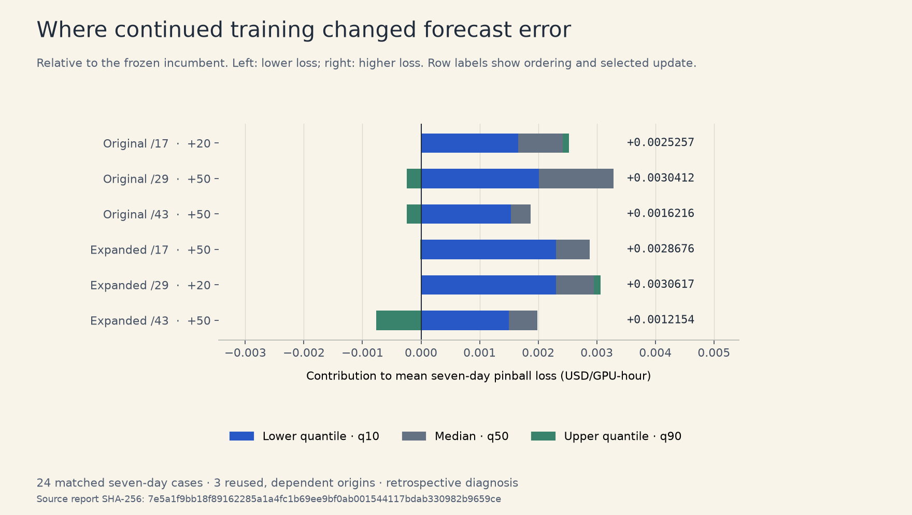

# Continuation distribution audit

This read-only audit uses retained probabilities. No training, model inference, new forecasts, checkpoint selection or prospective outcome retrieval occurred.

Source report: [results/ce-continuation-v21/runs/44144492740/report.json](../../../../results/ce-continuation-v21/runs/44144492740/report.json) · SHA-256 7e5a1f9bb18f89162285a1a4fc1b69ee9bf0ab001544117bdab330982b9659ce

| Arm / ordering | Selected update | 7d pinball | Coverage | Width | Median MAE | Entropy | Probability of no change |
|---|---:|---:|---:|---:|---:|---:|---:|
| Frozen incumbent | 0 | 0.01555766 | 0.833 | 0.11702519 | 0.04233698 | 0.77030 | 0.74675 |
| same /17 | 20 | 0.01808340 | 0.750 | 0.06719054 | 0.04690796 | 0.62278 | 0.80732 |
| same /29 | 50 | 0.01859890 | 0.792 | 0.05611754 | 0.05000782 | 0.55696 | 0.79808 |
| same /43 | 50 | 0.01717926 | 0.833 | 0.06151674 | 0.04434048 | 0.56532 | 0.75892 |
| expanded /17 | 50 | 0.01842522 | 0.750 | 0.05621137 | 0.04576798 | 0.82321 | 0.77734 |
| expanded /29 | 20 | 0.01861931 | 0.750 | 0.05976317 | 0.04622215 | 0.66971 | 0.80708 |
| expanded /43 | 50 | 0.01677306 | 0.750 | 0.03614525 | 0.04525497 | 0.72170 | 0.80465 |

## Reading the result

Lower development loss did not automatically transfer. Checkpoints remain the ones selected before retrospective evaluation. Narrower intervals alone are not better uncertainty; inspect coverage, width, median error and pinball together.

All ordering seeds share the same market outcomes. The source report retains paired loss contributions by origin, series, GPU and changed-price status. Probability drift, entropy and no-change mass show how predictions changed, but do not prove why generalization succeeded or failed.

| Arm | Completed orderings | Mean 7d loss | Orderings better than incumbent |
|---|---:|---:|---:|
| same | 3 | 0.017953853979269678 | 0 |
| expanded | 3 | 0.017939199393175252 | 0 |

## In plain language

We gave the already-trained forecasting model more practice. One condition reused its original price histories; the other drew from a broader verified pool. Model architecture, output levels, starting weights and optimization budgets were matched.

Original-data continuation had 15.40% higher mean seven-day loss than the incumbent across 3 completed ordering runs. 0 had lower aggregate loss. Lower loss is better; this is an average over the same historical cases.
Expanded-data continuation had 15.31% higher mean seven-day loss than the incumbent across 3 completed ordering runs. 0 had lower aggregate loss. Lower loss is better; this is an average over the same historical cases.

A good practice score did not establish better forecasts on another period. The originally selected checkpoints remain unchanged. We do not pick a seed or replace the official export using these retrospective scores.

The retained distributions show where confidence, interval width, coverage and errors changed. These observations can identify a behavioral failure, but cannot by themselves prove overfitting or establish that a proposed remedy works.

The recommended next step is a separately registered, short matched continuation with an incumbent-probability constraint, plus later observations for evaluation. See docs/ce-continuation-v21-next-steps.md. No further optimization is launched by this audit.

Public reconstruction: python -m compute_forecast.verify_continuation_v21; python scripts/diagnose_ce_continuation_v21.py.

Prospective improvement is not yet established.

The contributions reconstruct the exact aggregate difference. These are not confidence intervals.
