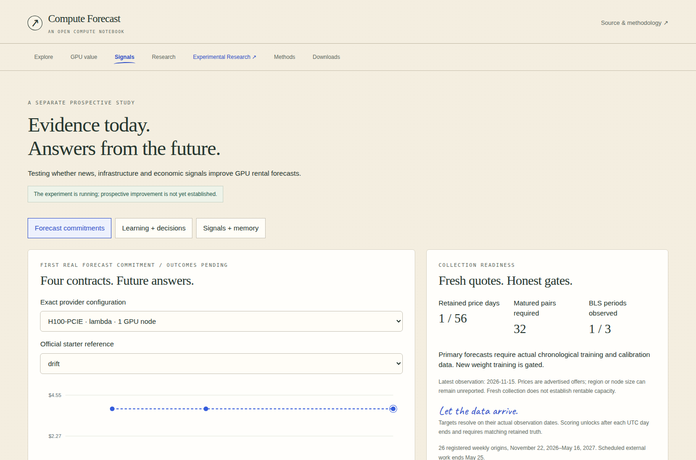
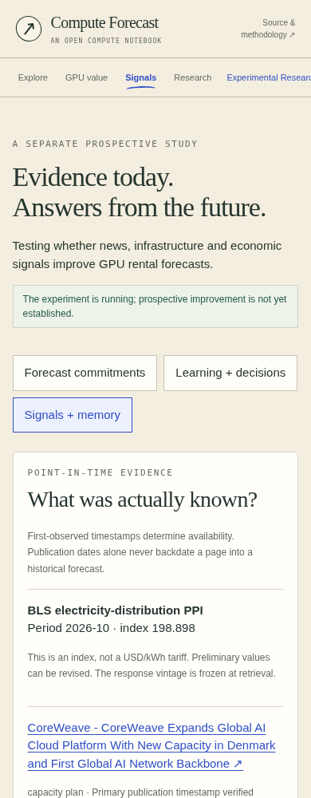

# Prospective signals v6

[Registered protocol](../../configs/prospective-signals-v6.json) · [Methods and limits](../../docs/prospective-signals-v6.md).

- [Initial source audit](runs/43763099038/audit.json): current-only source availability and BLS response.
- [Initial execution index](runs/43763941660/index.json): new four-contract cohort, one captured day, signals and 48 future reference rows.
- [Registration](runs/43763941660/registration.json): protocol/core hashes and pre-issuance commit.
- All files under each run retain immutable source identities and hashes. Snapshot and commitment filenames include their canonical record hash.
- Primary signal-model forecasts remain gated on actual retained history and matured labels.
- The cold-start pilot is not evidence of signal value; prospective accuracy remains pending.

## Interface and validation

[Signals notebook](https://howdymary--compute-forecast-observatory-web.us-east.modal.run/#signals) · [PNG hashes and validation report](ui-publication.json) · [Actual cross-role receipts](runs/43764698758/memory.json).

The new UI checks passed at1512,390 and320px, including exact48-row agreement, keyboard/touch controls, immutable pins, disclosure state and eight concurrent reads. All existing numerical contracts and the official export remain unchanged.
