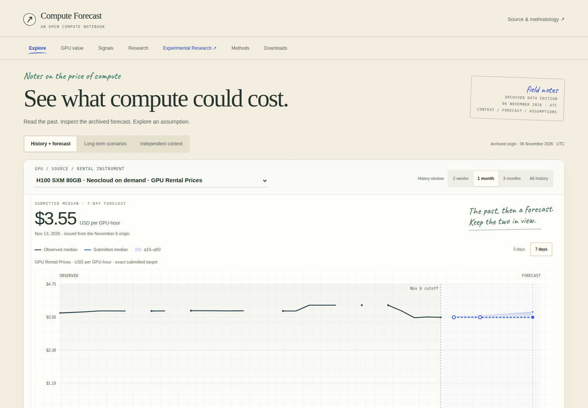
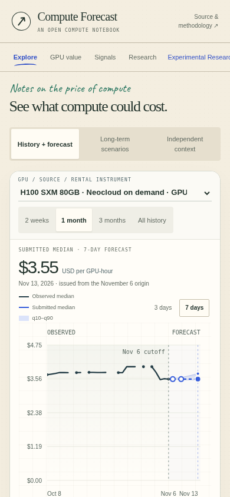

# Historical-price timeline v7

[Live Explore](https://howdymary--compute-forecast-observatory-web.us-east.modal.run/#explore) · [Methods](../../docs/timeline-v7.md) · [Validation and inspected PNG hashes](ui-publication.json).

The main chart now joins36 approved exact-target histories,3204 observed daily values, and the unchanged111-row forecast export. Missing days remain gaps. The excluded marketplace history remains withheld while its submitted forecast stays available.

All eight final UI suites passed. The timeline checks cover1512/390/320px, exact source joins, calendar geometry, immutable pins, keyboard/touch controls, loading/retry and a price line visible in the opening viewport. These are product checks, not new forecasting results.

